# Level generation

This document describes how the original levels are built and how `LevelGenerator` builds a level, stage by stage, with the types and methods that do each step. It is meant as a map for finding where a level property comes from and which code to change when a level goes wrong.

The guarantees every level keeps are in [One pass and guarantees](#one-pass-and-guarantees), the engine and level facts the generator follows are in [NOTES.md](NOTES.md), and the file layouts it writes are in [FORMATS.md](FORMATS.md). All code lives under `src/ASToolkit.Core/Generation/` unless a path says otherwise.

## Contents

1. [Original levels](#original-levels)
2. [Overview](#overview)
3. [Reference data](#reference-data)
4. [Coordinates](#coordinates)
5. [Target and budget](#target-and-budget)
6. [Mission graph](#mission-graph)
7. [Layout plan](#layout-plan)
8. [Fine layout and structure](#fine-layout-and-structure)
9. [Breaker spot](#breaker-spot)
10. [Dressing](#dressing)
11. [Content](#content)
12. [Script](#script)
13. [One pass and guarantees](#one-pass-and-guarantees)
14. [Level 1](#level-1-1)
15. [Add-on style and installation](#add-on-style-and-installation)
16. [Debugging](#debugging)

## Original levels

This section describes the layout, fights, loot and pacing of the original levels, read through the level survey (`LevelSurveyor`), the design report (`ascli inspect design`) and route images (`ascli analyze`). Places (`P`), encounters and landmarks are the ones the survey lists. **p** is the tour progress, the share of the route analysis's tour walked before a point, and areas are in square map pixels.

### Measures

| level | style | tour px | places | loops | revisit | start area | first fight p | hit points by fifth of the tour (%) |
|---|---|---|---|---|---|---|---|---|
| 2 | locked lab | 3,345 | 13 | 1 | 0.02 | 80,640 | 0.88 | 0 / 0 / 0 / 0 / 100 |
| 3 | locked lab | 11,792 | 50 | 6 | 0.04 | 80,640 | 0.41 | 0 / 0 / 20 / 60 / 20 |
| 4 | blackout lab | 19,799 | 36 | 2 | 0.15 | 117,600 | 0.07 | 30 / 66 / 0 / 1 / 2 |
| 5 | ungated lab | 22,484 | 36 | 1 | 0.01 | 62,720 | 0.04 | 14 / 8 / 7 / 65 / 5 |
| 6 | military | 12,949 | 12 | 1 | 0.07 | 103,680 | 0.05 | 32 / 49 / 0 / 14 / 5 |
| 7 | military | 26,698 | 17 | 0 | 0.14 | 86,400 | 0.06 | 33 / 37 / 6 / 0 / 24 |
| 8 | military | 22,639 | 7 | 0 | 0.11 | 866,160 | 0.02 | 27 / 48 / 9 / 9 / 8 |
| 9 | military | 43,843 | 7 | 0 | 0.14 | 972,000 | 0.02 | 54 / 44 / 2 / 0 / 0 |
| 10 | military | 20,789 | 28 | 0 | 0.04 | 103,680 | 0.40 | 0 / 100 / 0 / 0 / 0 |
| add-on 1 level 2 | blackout lab | 34,886 | 36 | 3 | 0.09 | 474,320 | 0.00 | 27 / 37 / 20 / 11 / 5 |
| add-on 1 level 3 | ungated lab | 25,707 | 23 | 0 | 0.05 | 2,236,640 | 0.00 | 65 / 12 / 2 / 16 / 4 |
| add-on 1 level 4 | ungated lab | 18,603 | 12 | 1 | 0.02 | 485,520 | 0.00 | 77 / 9 / 4 / 7 / 3 |
| add-on 1 level 5 | ungated military | 22,004 | 5 | 0 | 0.03 | 1,000,080 | 0.00 | 72 / 1 / 19 / 1 / 6 |
| add-on 2 level 2 | ungated lab | 20,019 | 18 | 0 | 0.08 | 491,120 | 0.00 | 99 / 0 / 0 / 0 / 1 |
| add-on 2 level 3 | ungated lab | 6,323 | 23 | 4 | 0.02 | 5,246,080 | 0.24 | 0 / 84 / 4 / 4 / 8 |
| add-on 2 level 4 | fenced military | 28,189 | 8 | 0 | 0.07 | 339,120 | 0.00 | 46 / 34 / 16 / 4 / 0 |
| add-on 2 level 5 | ungated lab | 33,715 | 18 | 2 | 0.05 | 7,963,200 | 0.01 | 53 / 5 / 26 / 0 / 16 |

The start area is the area of the place holding the player start. The three level 1 maps are described on their own below.

### Level 1

Each campaign has a level 1 of its own, on an outdoor map with a different win.

| map | size | ground | win | contents |
|---|---|---|---|---|
| campaign | 2,000 by 2,000 | grass tiles 505, 506 and 507 | the player comes within 70 px of (1550, 1295) | no monsters and no spawners; 19 crates, 4 money, 8 street lamps, two walled buildings and a chain-link fence (660) |
| add-on 1 | 2,000 by 2,000 | grass tiles around lab buildings on 500 floor | the player comes within 40 px of (120, 320) | 55 placed monsters (50 and 53), 2 spawners, 3 spawn walls, 1 charge, 1 site, a shotgun and 13 doors |
| add-on 2 | 4,000 by 3,000 | city streets on 503 tiles between buildings under 5,499 earth tiles | every monster dead (`CompaignGameTact`) | 16 spawners, 42 bats (880) in one corner, 2 shotguns, a grenade launcher and two implants |

- The campaign level is a walk. The player starts at (145, 1908) on a dirt road that ends at the fence gate (661), which stays shut. The way in is the torn piece (662) on the far side of the compound. The exit lies inside the small building, 46 px from a breakable wall (625), and its door (617 at z 0) stays shut. The tour runs 4,248 px around the fence and through the wall. Four money pickups lie in a row by the first building.
- On add-on 1 the tour enters the compound through its torn piece next to the shut gate and runs 7,983 px. The exit is 70 px from the only dynamite site and 36 px from a spawn wall (618). The charge lies 1,235 px from the site at (1404, 499), and the shotgun lies at (407, 1201). Most placed monsters stand around (1300, 800), in the middle of the compound.
- Add-on 2 starts the player in the top left corner of a city block, with spawners spread over the streets and buildings that open by doors. Its tour of 16,406 px follows the streets to every monster group.
- The ground is a grid of tiles over the whole map, 505 on the campaign and add-on 1 (132 px apart in a row, rows 47 px apart and shifted by 66 px in turn) and 501 on add-on 2 (80 px apart in a row, rows 28 px apart and shifted by 40 px). Alone it reads as dirt. Clumps of 506 lie over it wherever the ground is grass, and tufts of 507 line the edge where the grass meets the dirt. On the campaign the grass covers everything but the yard inside the fence, the road from the start to the gate and the strip in front of the buildings.
- The campaign's street lamps (663) stand on the fence posts halfway between two pieces and face into the compound, 64 on the upper `\` side, 192 on the lower `\` side and 128 on the lower `/` side. Its torn piece lies on a `/` side with facing 0, and the two gate pieces lie on a `\` side with facings 0 and 128.
- The campaign's crates (419), containers (400, some stacked at z 60), barrels (401), trucks (440) and containers 442 stand in clusters of 2 to 6 against the fence and the building walls. Three gas cylinders (402) lean on the breakable wall and two barrels stand just outside it.

### Locked labs (levels 2 and 3)

- **Level 2.** The start room (P1) opens on a hall (P2) with two locked doors in view. The breaker room (P3) opens off the hall at p 0.46, with 68 blood decals, 2 transformers and a corpse. Behind the locked doors two rooms hold all 56 monsters, 14 in a line (P5) and 42 in a grid (P6). The first fight is at p 0.88. Five health pickups lie ahead of the first group, in its room and the one before, and the last room holds crates of money. The only shotgun lies in a secret closet off a locked storage room that the tour does not need.
- **Level 3.** The start hall (P2) shows 4 locked keypads and a breakable wall. The breaker room (P6, p 0.24) also holds the level's only charge. Behind the gate the tour runs through 14 rooms with 6 loops, and the fights peak in the fourth fifth with 48 placed monsters in the furnished room P12, which also holds 19 pickups and the minigun. The boss 850 stands in a dead-end lab (P16, p 0.73) with 12 escorts and the dynamite site, whose hole hides 4 endless generators. The breaker also opens 13 monster-free office and storage rooms in three branches off the start hall. 73% of the level's pickups lie off the tour, in these rooms and in the secret closets. Three spawn closets release streams of 10 to 13 monsters, and 9 secret closets hold money, ammo, the grenade launcher, an implant and an extra life.

### Blackout labs (level 4 and add-on 1 level 2)

- **Level 4.** The blackout trigger and the checkpoint lie in P3 at p 0.07 to 0.08. The next room (P4) holds the grenade launcher in a crate, and the one after it (P5) holds 188 placed monsters with 1,886 hit points, the largest placed group of the lab levels. The breaker room (P11, p 0.41) has 4 transformers, and coming within 100 px of it sets off 107 monsters from 7 spawners. The three charges lie in a dead end next to it (P12, p 0.47). The three sites lie at p 0.57, 0.69 and 0.94, back across the level. The tour re-walks 15% of itself, the most of any original. Ten office and storage rooms off the first hall hold loot and no monsters.
- **Add-on 1 level 2.** The trigger is 69 px from the start. The breaker (p 0.15) sets off 3 ambushes. 63% of the floor lies behind 34 locked doors, and four sites follow at p 0.45 to 1.0.

### Ungated lab (level 5)

The start room is the smallest of all originals (62,720). The first ambush comes at p 0.04 with 75 monsters from 2 spawn closets. The first half is office rooms with placed groups of monsters 50, 53 and 56. The second half is large lab rooms of 300,000 to 770,000 where every fight is a slug ambush (40, 43 and 46) from side rooms and closets, from p 0.39 on. The checkpoint (p 0.48) comes after the first of them, and the peak is in the fourth fifth. The boss 860 stands at p 0.81 in a 770,000 dead-end room with four yellow slugs. Eleven secret closets hold money with a perk, the rocket launcher and the minigun.

### Fenced military (levels 6 to 10)

- **Level 6.** A small start room opens on a 1,416,960 yard (P2), where two ambushes of about 100 monsters come at p 0.05 and 0.07. The generator room (P5, p 0.29) ends a chain of three rooms, and a 108-monster ambush triggers in the room before it. The fences open onto the last office (P10), where 3 red weapon monsters guard 10 money.
- **Level 7.** The generator is at p 0.10, and a 119-monster ambush triggers in the room before it. 67% of the base lies behind the fences. The largest hall (P10) holds the cannon (p 0.51), 3 pads, 47 placed monsters and the site at p 1.0. The charge lies in a far dead end (P13, p 0.77), and the tour walks back to the site, re-walking 14% of itself.
- **Level 8.** The start hall is itself a site, and three pad ambushes come at p 0.02 to 0.05. The checkpoint (p 0.19) stands before the generator room, whose two generators (p 0.21 and 0.22) share it with three charges. The fenced yard P5 (2,257,920) holds the cannon and a 135-monster pad ambush with 85,300 hit points, and the boss 867 waits in a dead-end hall beside a site and 3 pads (p 0.59). Six sites run from p 0.39 to 1.0.
- **Level 9.** The start yard holds 110 placed monsters, most of them weapon monsters, and 6 charges, and four waves of 254 to 360 monsters come by p 0.26. 98% of the hit points lie in the first two fifths. The nine sites lie in three places (P1, P2 and P7) from p 0.59 to 1.0, with endless generators behind their pads, and the tour of 43,843 px is the longest of all originals.
- **Level 10.** No monster appears until p 0.40. The first generator (p 0.13) drops 21 fences, and the central arena (P6, 4,534,560) holds 20 large health pickups, 23 boxes of magma minigun ammo and 7 implants and perks. The checkpoint (p 0.31) is in the arena. The second generator stands in a dead-end hall (P7, p 0.42), and entering the hall sets off one ambush of 1,408 monsters from 25 spawners in 8 fenced pens around the arena, which is 99.9% of the level's hit points and brings the boss 866. Two small lairs of placed monsters end the level. A gory secret lab (539 blood decals) lies off the start hall.

### Add-on levels

- Every add-on level except add-on 2 level 3 has its first fight by p 0.01, and six of the eight have the largest share of their hit points in the first fifth.
- Their start areas are large halls and yards of 339,120 to 7,963,200. The campaign labs and levels 6, 7 and 10 start in rooms of 62,720 to 117,600.
- Add-on 2 level 2 starts in an office of 491,120, and six ambushes start at p 0.00 to 0.002, the largest with 763 monsters from 12 spawners in side rooms. A seventh of 30 bats comes at p 0.88. Every monster of the level comes from ambushes, and the rest of the tour collects money and ammo from office rooms and 6 secret closets.
- Add-on 2 level 4 is a fenced military level with a blackout trigger at p 0.03. A 1,393-monster ambush starts at the start room, four generators share one room at p 0.18, and a breaker at p 0.84 opens nothing. The cannon stands in the fourth largest place on the tour.
- Add-on 1 level 3 starts in a 2,236,640 hub hall that opens by doors onto four large rooms, and three ambushes with 37,482 hit points start at p 0.00. Each of its sites has its own charge.
- Add-on 1 level 4 is a ring of 12 storage rooms joined by openings, with 9 sites in order around it and the cannon in the largest room.
- Add-on 1 level 5 starts in a yard where three pad ambushes with 215,609 hit points start at p 0.00.
- Add-on 2 levels 3 and 5 are a single yard of 5,246,080 and 7,963,200 with buildings around it, each joined by doors. Level 5 ends with the diver boss 890 in a dead-end storage room.

### Room graph

Measured on the ten lab originals (campaign levels 2 to 5, add-on 1 levels 2 to 4 and add-on 2 levels 2, 3 and 5) from the survey's places and connections. Rooms and halls are the nodes, and doorways, doors and openings of every kind are the edges. Closets, secret walls, spawn walls and monster holes are left out. The main body is every room on some path from the start to the end of the tour, and a branch is a group of rooms joined to the main body through one room. Cycles count the independent cycles of the door graph, including loops the tour does not walk. An objective's depth is the number of rooms between its room and the main body. A room is square when its length is within 15% of its width, and irregular when it fills under 80% of its bounding box.

| level | rooms | under 70,000 | cycles | main body | hub doors, rooms from the start | branches of 2+ rooms, largest, deepest | loot rooms | objective depths | square | no notch, small, mid, large | notches open outside |
|---|---|---|---|---|---|---|---|---|---|---|---|
| 2 | 11 | 4 | 1 | 65% | 6, 1 | 2, 2, 2 | 5 | 1 | 36% | 80, 0, 0% | 82% |
| 3 | 37 | 14 | 8 | 60% | 7, 1 | 3, 9, 6 | 9 | 1, 1, 3, 3 | 16% | 67, 36%, none | 74% |
| 4 | 28 | 10 | 6 | 75% | 6, 1 | 2, 7, 6 | 13 | 0, 0, 1, 1, 1 | 14% | 78, 20, 33% | 53% |
| 5 | 22 | 7 | 2 | 61% | 5, 2 | 2, 6, 6 | 1 | 1 | 23% | 100, 25, 0% | 88% |
| add-on 1 level 2 | 27 | 2 | 3 | 69% | 5, 2 | 2, 7, 5 | 3 | 0 (5), 2, 4, 5 | 0% | 100, 62, 38% | 33% |
| add-on 1 level 3 | 8 | 1 | 0 | 58% | 4, 0 | 2, 3, 2 | 0 | 0 (3), 1 (3), 2 | 12% | 100, 100, 0% | 100% |
| add-on 1 level 4 | 12 | 0 | 1 | 100% | 2, 0 | none | 0 | 0 (14) | 25% | none, 83, 20% | 57% |
| add-on 2 level 2 | 11 | 0 | 0 | 80% | 5, 1 | 1, 2, 2 | 5 | none | 18% | none, 33, 50% | 82% |
| add-on 2 level 3 | 19 | 11 | 4 | 69% | 8, 0 | 4, 9, 9 | 13 | none | 16% | 100, 100, 0% | 100% |
| add-on 2 level 5 | 26 | 5 | 0 | 67% | 4, 1 | 2, 8, 4 | 2 | 0, 0 | 8% | 100, 100, 30% | 71% |

- Every level but the ring of add-on 1 level 4 has a hub of 4 to 8 doors at most two rooms from the start. The branches of two or more rooms hang off the hub on 8 of the 9 levels, and add-on 1 level 2 hangs its two from rooms farther on.
- The main body holds 58 to 80% of the floor, and no branch holds more than 20%. It runs through the large rooms, a median of 144 units against 36 in the branches, and 11 of the 17 halls lie on it. The cycles lie in the main body, apart from one in level 3's key branch and two in a branch of add-on 2 level 5.
- Branches are trees of up to 9 rooms and 9 rooms deep that split up to 4 ways. The loot branches (the monster-free branches of the patterns below) add up to 0 to 13 rooms a level, entered through locked or jammed doors on levels 3 and 4.
- The campaign keeps objectives in the main body or one room off it. Level 3's key branch is the exception, with the breaker and the charge 3 rooms in. Add-on 1 level 2 puts its breaker and its charges and site at the ends of branches 2 to 5 rooms deep.
- The gate splits the level into two parts. Once the tour enters the second, it never walks back into a room of the first on levels 2, 3 and 4, and re-enters one room (6% of the rest of the tour) on add-on 1 level 2. On level 3 and add-on 1 level 2 the tour walks back out of the key branch (4 and 5 rooms) before it enters the second part. Level 4's blackout search runs through the main body (7 of its 8 rooms), and the locked labs keep the key in a branch off the hub.
- Ambushes on levels 2 to 4 spawn only into rooms the tour walks after the trigger, as level 4's breaker trap does into P9. Level 5 spawns two small ones (10% of its ambush hit points) into rooms the tour has left for good. Every triggered spawner stands in a closet, on the main body or one room off it, apart from two 2 rooms off on add-on 2 level 5. Their monsters stop a median 17% of the way to the trigger (quartiles 9 and 31%).
- A notch is a part of a room's bounding box outside the room at least 2 cells across and 4% of the box. Notches sit at corners (123 of 128) and take 7 to 23% of the box (deciles 1 and 9), with a short side of 2 to 12 units.
- Shape follows size. Over the ten levels, rooms under 100,000 px² have no notch 81% of the time, rooms of 100,000 to 400,000 px² 51% and larger rooms 26%, and 55% of the large rooms have two or more notches. Room areas run from 16 to 302 units (deciles 1 and 9).
- 77% of the notches open outside where the building's outline steps, 20% hold a neighboring room, hall or yard and 4% a closet.

### Phases

A phase is one state of a level between the keys that change it (`ProgressionMeasurer`, with the rules in [NOTES.md](NOTES.md#phases-and-beats)). Each phase has an entrance, a critical path from the entrance through its charges and objectives to its keys and the way on, room trees off that path and loops. A return pass walks back over earlier rooms to the rooms its key opened. The critical path counts the places walked, a place walked twice counting twice.

| level | phases | rooms per phase | critical path | loops | ways back closed |
|---|---|---|---|---|---|
| 2 | 2 | 5, 6 | 4, 3 | 0, 0 | - |
| 3 | 2 | 9, 29 | 8, 11 | 2, 3 | - |
| 4 | 3 | 12, 10, 6 (return pass) | 2, 9, 12 | 1, 0, 0 | the blackout trigger locks the door from place 3 to 2 |
| 5 | 1 | 22 | 11 | 1 | - |
| 6 | 2 | 9, 3 | 7, 2 | 1, 0 | - |
| 7 | 2 | 7, 10 | 8, 9 | 0, 0 | - |
| 8 | 2 | 5, 2 | 16, 2 | 0, 0 | - |
| 9 | 2 | 5, 2 | 12, 2 | 0, 0 | - |
| 10 | 3 | 7, 3, 19 (return pass) | 5, 3, 4 | 0, 0, 0 | rubble between place 6 and 5 |
| add-on 1 level 2 | 3 | 3, 7, 16 | 1, 12, 29 | 0, 0, 0 | - |
| add-on 1 level 3 | 1 | 8 | 14 | 0 | - |
| add-on 1 level 4 | 1 | 12 | 17 | 1 | - |
| add-on 1 level 5 | 1 | 5 | 11 | 0 | - |
| add-on 2 level 2 | 1 | 11 | 6 | 0 | - |
| add-on 2 level 3 | 1 | 19 | 1 | 4 | - |
| add-on 2 level 4 | 2 | 5, 3 | 12, 2 | 0, 0 | - |
| add-on 2 level 5 | 1 | 24 | 8 | 0 | - |

- The locked-door labs have two phases, the start and the breaker part, then the part the breaker opens. Level 3's second phase holds 29 of its 38 rooms.
- Level 4 is a quiet phase, a blackout phase to the breaker, and a return pass over the 6 rooms the breaker opened to the dynamite sites. Level 10's third phase starts at its second generator and reads as a return pass.
- The fenced levels have a yard phase and a phase behind the fence of 2 or 3 rooms, except level 7 with 10.
- Only levels 4 and 10 close a way back.
- Add-on 2 level 3's critical path is one place long, since its survey finds no connections.

**Beats.** `BeatMeasurer` reads the fights, keys, locks, pickups, set pieces and goals of a level as beats along its tour, each with its phase, position along the phase's tour span and fight intensity (hit points within 800 px of tour on either side, per tour pixel). A lock beat is the first place the tour reaches in each phase after the first. Measured on campaign levels 2 to 10:
- The largest fight of a phase with two or more fights sits at a median position of 0.36 along it, median of levels.
- All 13 phase climaxes are followed by fewer hit points in the next tenth of the tour than in the tenth before.
- The tour reaches the lock of the first phase a key opens before the key on all 8 gated levels, and the breaker or generator of all 7 locked-door and fence gates lies in a phase before the one it opens.
- 7 of the 8 weapons new to the campaign come after the first pickup of their ammo in the level that brings them. Only level 10's magma minigun comes first.

### Campaign curves

`ascli inspect design` writes these per-level curves of the campaign and both add-ons to `campaign.md`. Hit points count standing and spawned monsters, money counts the cash pickups at 50 each, and end money is what the level money tables of `common_table.lgc` pay at the end of the level, nothing after the last.

| level | campaign hit points | spawned | end money | add-on 1 hit points | end money | add-on 2 hit points | end money |
|---|---|---|---|---|---|---|---|
| 1 | 0 | 0 | 100 | 564 | 850 | 7,852 | 850 |
| 2 | 336 | 0 | 350 | 7,958 | 4,800 | 52,910 | 4,800 |
| 3 | 1,682 | 0.14 | 1,000 | 60,409 | 10,000 | 115,556 | 10,000 |
| 4 | 6,526 | 0.66 | 2,800 | 243,363 | 18,000 | 909,459 | 18,000 |
| 5 | 21,261 | 0.89 | 5,500 | 331,465 | 0 | 1,043,200 | 0 |
| 6 | 27,894 | 0.95 | 9,000 | | | | |
| 7 | 52,923 | 0.94 | 18,000 | | | | |
| 8 | 197,861 | 0.87 | 29,000 | | | | |
| 9 | 1,036,618 | 0.88 | 32,000 | | | | |
| 10 | 745,142 | 1.00 | 0 | | | | |

- Every campaign puts its lab levels before its military ones. The theme is the floor's. Add-on 1 level 4 and add-on 2 level 5 lay lab walls on military floor (see [NOTES.md](NOTES.md#lab-lattice)), and both add-ons run lab at levels 2 and 3 and military at 4 and 5.
- Every campaign brings its weapons in shop-price order, except the campaign's plasma rifle in a level 4 spawn closet, a level before the rocket launcher.

- The add-ons are shorter and harder. Each covers the campaign's arc of monsters, weapons and money in 5 levels. Add-on 1 passes the hit points of campaign level 8 at its level 4, and add-on 2 those of campaign level 10 at its level 4.
- The campaign brings in about one weapon a level from level 2 to 10. Add-on 1 hands out four at its level 2, and add-on 2 seven by its level 3.
- New monster kinds come in steps. Each campaign lab level adds one to four, and levels 6 and 8 add the weapon monsters and the tank weapon monsters. Add-on 1 meets by its level 3 the kinds of campaign levels 5, 6 and 8, and add-on 2 by its level 2 those of level 6.

### Rooms

Every room of every original has a role and a type, read by `RoomAtlas` (`src/ASToolkit.Core/Rooms/`) from the survey and the sprites. `ascli inspect rooms` writes a cropped image of each room with its role and type, sheets of them per level, `rooms.tsv` and the tables below.

- **Role** is where the room stands on the door graph (`RoomRoleMap`). The roles are start, hub (the first hall on the way to the end), neck (the room after the hub), other halls of the main body, rooms on the sides of the hub (hub row) and of the second hall (hall row), other main body rooms, and branch roots and inner branch rooms. The key room of a gate, when it stands alone off the main body, is its own role. Closets and nooks, rooms behind breakable walls and ground outside the walls are left out of the tables.
- **Type** is what the room is furnished as. The classifier scores each room by its defining group. A desk (a table with a chair within 70 px or a computer within 40 px) scores 4, plus one for each cabinet in a room with desks. Lab tubes, flasks and equipment score 1 each, big computers and 443 server banks 2, transformers and panels 2, containers, trucks and missiles 2, and shelves, cabinets, boxes and cylinders 1. Crates and barrels count as stock, toward depot when the room holds a container and toward storage when not. A room with fewer than 3 pieces is a passage when it has 2 doors or more and bare when not. Halls and corridors are halls.
- **Read by eye.** 35 rooms the classifier cannot type from their pieces are typed in `RoomAtlas.Corrections`, each keyed by a point inside the room. They are split rooms (a walkway with an office, lab or depot side, add-on 1 levels 2 and 3), room-shaped halls (level 5's P12, level 10's corridor maze), level 10's arena bays, add-on 2 level 3's gym and washrooms, and a handful of misreads.
- **Setting.** Add-on 1 level 4 and add-on 2 level 5 are built from lab walls on military floor. The survey keeps their theme as lab (the walls and grid are the lab ones) and gives them a military setting, and segments them as open plan like the military levels.

| type | rooms | area (k px², min / median / max) | fill | where |
|---|---|---|---|---|
| passage | 37 | 26 / 51 / 334 | 0.96 | branch roots, necks, level 10's airlocks |
| bare | 7 | 35 / 86 / 620 | 0.95 | four start rooms and three one-door branch roots |
| hall | 30 | 120 / 468 / 5,079 | 0.78 | hubs and halls of the main body |
| office | 64 | 24 / 145 / 1,839 | 0.86 | branches and the main body of labs |
| lab | 8 | 80 / 239 / 1,346 | 0.94 | branches and the second hall's rows |
| computer room | 8 | 172 / 506 / 1,656 | 0.87 | level 5's pods, military key rooms |
| machine room | 5 | 35 / 91 / 103 | 0.91 | key rooms (the breaker) and small branch rooms |
| storage | 27 | 33 / 103 / 470 | 0.92 | small branch rooms |
| depot | 66 | 35 / 465 / 2,880 | 0.83 | the main body of level 4, military levels and the military-setting add-ons |
| quarters | 2 | 591 | 1.00 | add-on 2 level 3 only |
| arena | 10 | 305 / 408 / 599 | 0.86 | level 10 only |

Lab rooms by role and type (campaign levels 2 to 5, add-on 1 levels 2 and 3, add-on 2 levels 2 and 3):

| role | passage | bare | hall | office | lab | computer | machine | storage | depot | quarters |
|---|---|---|---|---|---|---|---|---|---|---|
| start | 0 | 2 | 3 | 2 | 0 | 0 | 0 | 0 | 1 | 0 |
| hub | 0 | 0 | 5 | 0 | 0 | 0 | 0 | 0 | 0 | 0 |
| neck | 2 | 0 | 3 | 1 | 0 | 0 | 0 | 0 | 1 | 0 |
| hall | 0 | 0 | 2 | 0 | 1 | 0 | 0 | 0 | 0 | 0 |
| hub row | 0 | 0 | 0 | 1 | 0 | 0 | 0 | 0 | 1 | 0 |
| hall row | 3 | 0 | 0 | 2 | 1 | 2 | 0 | 1 | 0 | 0 |
| body | 7 | 0 | 0 | 10 | 1 | 1 | 0 | 3 | 7 | 0 |
| branch root | 5 | 1 | 3 | 12 | 2 | 1 | 0 | 6 | 1 | 0 |
| branch | 4 | 0 | 1 | 29 | 2 | 1 | 1 | 9 | 4 | 2 |
| key | 0 | 0 | 0 | 0 | 0 | 0 | 2 | 0 | 0 | 0 |

| lab level | passage | bare | hall | office | lab | computer | machine | storage | depot | quarters |
|---|---|---|---|---|---|---|---|---|---|---|
| 2 | 1 | 0 | 1 | 5 | 0 | 0 | 1 | 2 | 1 | 0 |
| 3 | 9 | 1 | 4 | 12 | 3 | 0 | 1 | 4 | 2 | 0 |
| 4 | 3 | 1 | 1 | 7 | 0 | 0 | 1 | 7 | 8 | 0 |
| 5 | 6 | 1 | 3 | 5 | 0 | 4 | 0 | 1 | 1 | 0 |
| add-on 1 level 2 | 0 | 0 | 3 | 14 | 3 | 0 | 0 | 3 | 3 | 0 |
| add-on 1 level 3 | 1 | 0 | 2 | 5 | 0 | 0 | 0 | 0 | 0 | 0 |
| add-on 2 level 2 | 0 | 0 | 2 | 9 | 0 | 0 | 0 | 0 | 0 | 0 |
| add-on 2 level 3 | 1 | 0 | 1 | 0 | 1 | 1 | 0 | 2 | 0 | 2 |

| military level | passage | bare | hall | office | lab | computer | machine | storage | depot | arena |
|---|---|---|---|---|---|---|---|---|---|---|
| 6 | 2 | 0 | 1 | 2 | 0 | 1 | 1 | 3 | 2 | 0 |
| 7 | 2 | 2 | 2 | 4 | 1 | 0 | 0 | 3 | 3 | 0 |
| 8 | 0 | 0 | 3 | 0 | 0 | 1 | 1 | 0 | 2 | 0 |
| 9 | 0 | 0 | 2 | 0 | 0 | 1 | 0 | 0 | 4 | 0 |
| 10 | 10 | 1 | 4 | 0 | 0 | 0 | 0 | 0 | 1 | 10 |
| add-on 1 level 4 | 0 | 0 | 1 | 0 | 0 | 0 | 0 | 1 | 10 | 0 |
| add-on 1 level 5 | 0 | 0 | 0 | 0 | 0 | 0 | 0 | 1 | 4 | 0 |
| add-on 2 level 4 | 0 | 0 | 0 | 1 | 0 | 0 | 0 | 0 | 7 | 0 |
| add-on 2 level 5 | 2 | 1 | 0 | 0 | 0 | 0 | 0 | 0 | 18 | 0 |

- The only empty rooms are passages (median 51k px²), the bare rooms and level 10's arena bays.
- Offices make up half the lab branch rooms and a third of the main body. Storage rooms are small (median 103k) and stand in branches. Depots are big (median 465k) and fill the main body of level 4 and the military levels.
- The hub and the halls carry hall dressing only. A hall with desks on one side is a split room (add-on 1 level 2's start, P2 and the six-office walkway P5), and its walkway stays bare.
- The breaker stands in a small machine room on campaign levels 2, 3, 4 and 6, and the add-ons put it in an office or a depot.

Two examples of each type, with the room outlined in yellow, walls inside it in orange and its floor tinted:

| type | examples |
|---|---|
| office | 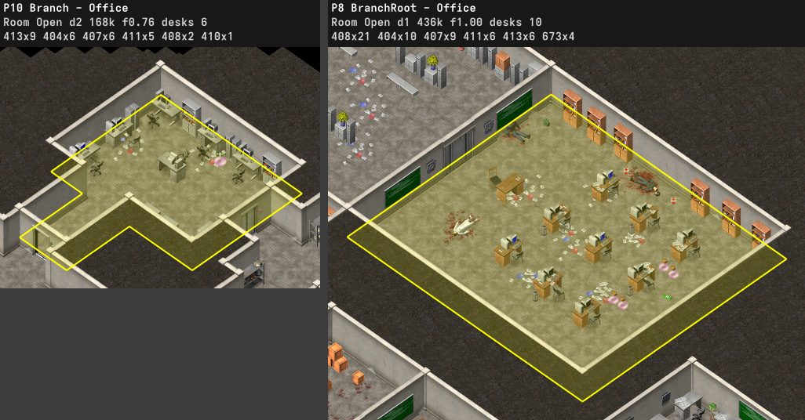 |
| lab | 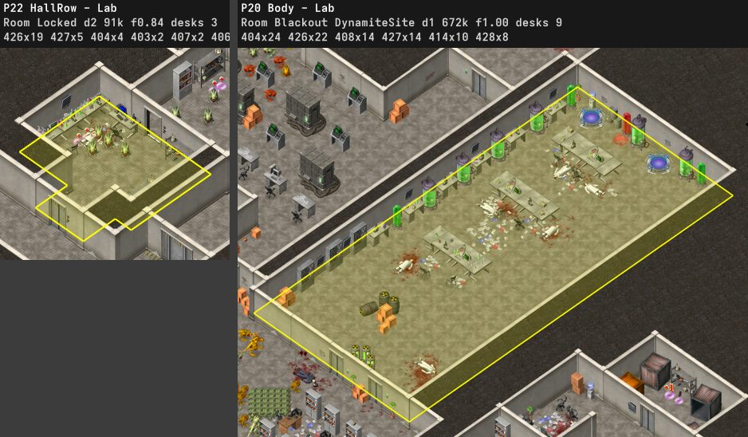 |
| computer room | 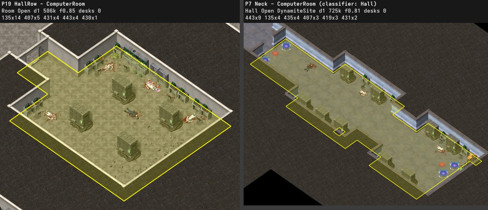 |
| machine room | 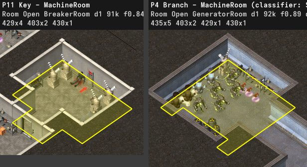 |
| storage | 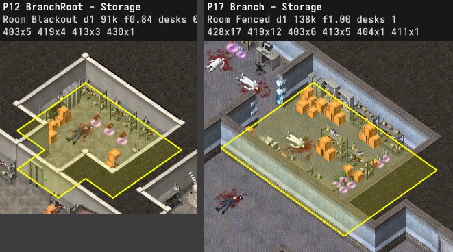 |
| depot | 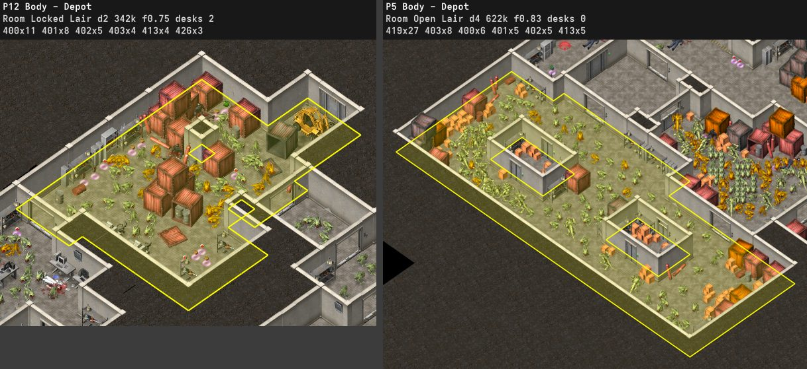 |
| hall | 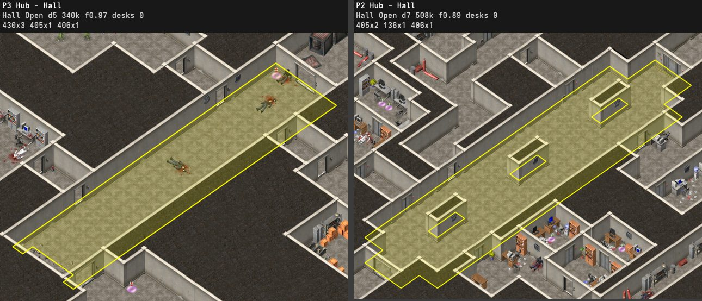 |
| hall with an office side | 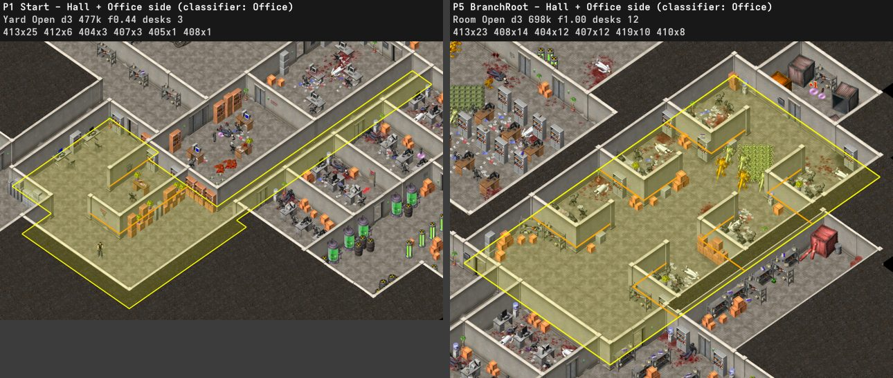 |
| quarters | 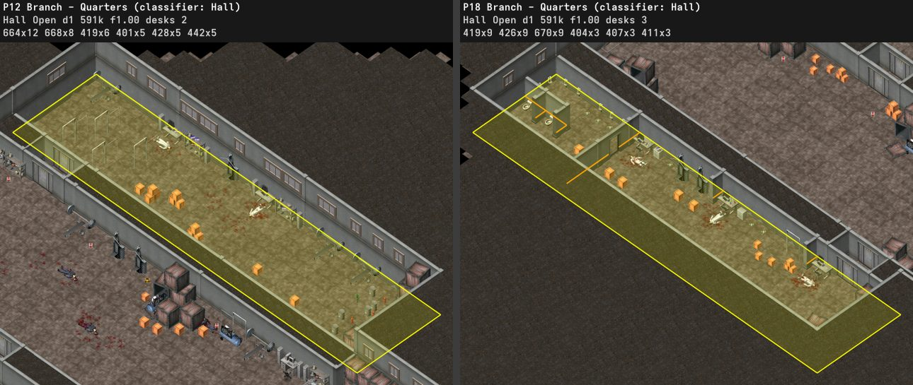 |
| passage | 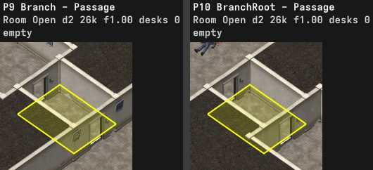 |
| arena | 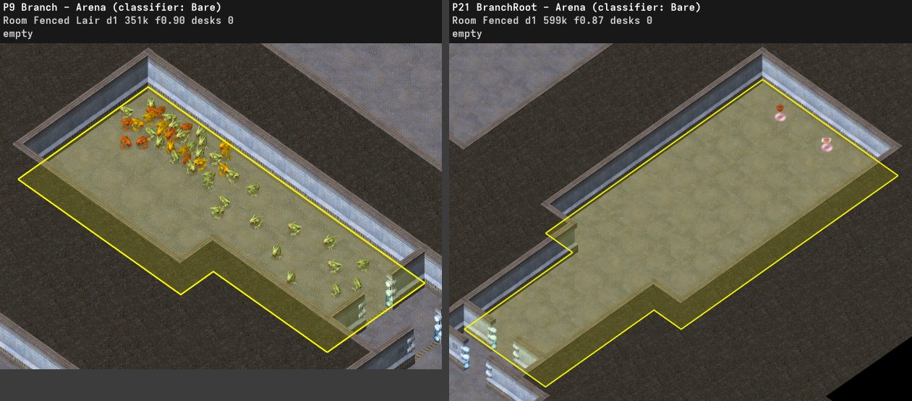 |

### Recipes

A recipe says how the originals furnish a type of room. `PartFinder` groups each room's furniture into parts by the pairs the originals build, a table with its chair (within 70 px), computer (45) or labware (50), cabinets and shelves into bands (60 to 100), crates and boxes into stacks (55), containers into rows (90), server banks in spaced rows (150), a wall computer with its chair (60), barrels and cylinders (45). A piece standing on another joins the other's part (`ObjectTableExtensions.FindSupport`), and a part is named after the groups with a piece on the floor (boxes on a cabinet make a cabinet part). A part stands against a wall, in a corner (two walls within 2 cells) or in the open. Papers and corpses are counted per area. `RoomRecipe.Measure` pools the parts of a type's rooms, kept apart for labs and military settings, into each kind of part's rate per 100,000 px² of floor, the share of rooms that hold one, where it stands, how far apart two stand in a room and how often the nearest one stands along a lattice axis (in a row), and its examples with their geometry. A kind held by 75% of the rooms or more is required. `ascli inspect rooms` writes the full tables to `recipes.md`.

The defining parts of the lab types (campaign and add-ons):

| type | rooms | required parts | common parts |
|---|---|---|---|
| office | 57 | desk of table, chair and computer (86%, 57% in the open), cabinets (75%, 63% against a wall, rows of up to 17) | plants (40%), table and chair (40%), wall screens (39%), water cooler (33%), cabinet row with a cooler (21%) |
| lab | 6 | labware (83%) | lab tables with chairs (67%), boxes (50%), shelves (50%), crates (50%) |
| computer room | 5 | server banks (100%, 86% in the open), wall computers (100%), chairs (80%) | machines (40%) |
| machine room | 3 | machines (100%, 62% in corners), shelves (100%) | |
| storage | 19 | shelves (79%, in corners and along walls) | crates (53%), cabinet and shelf bands (53%, all against walls), boxes (37%) |
| depot | 15 | containers (100%, 60% against a wall) | shelves (67%), crates (67%), barrels (60%), container and crate groups (47%) |
| hall | 13 | | wall screens (54%), cabinets, crates and barrels against walls (31% each) |

In military depots (51 rooms) barrels against walls are the one required part (76%), and containers (73%), crates (57%) and barrels (53%) also stand in the open, with forklifts in 31% of them.

### Furniture

| object | stands next to | originals |
|---|---|---|
| chair 407 | a table 404, within 60 px (median 38) | 476 of 510 |
| chair 678 (add-on 2 levels 2 and 4) | a table 404, within 60 px | 21 of 21 |
| big computer 135 on level 5 | a chair, within 200 px | 52 of 52 |
| computer 410 and dead computer 411 | a table, within 60 px | 107 of 107 and 231 of 231 |
| test tubes 426 and lab equipment 427 | a table, within 60 px | 98% of 205 and 99% of 85 |
| scattered paper 408 | a table, within 60 px | 70% of 458 |
| explosion sparks 174 | a big explosion 157, within 60 px | 186 of 186 |

- The table's frame sets the side its chair stands on. Frames 192 and 21 put it to the lower left (71 of 86 and 42 of 45), and frames 0 and 85 to the lower right (56 of 67 and 52 of 62).
- Level 5 has 17 of its 59 chairs away from tables, in front of big computers. Level 6's machine room has 15 big computers and 2 chairs.
- Level 3's three lab rooms, 36 to 47 units, hold 1, 4 and 5 tables. The two larger carry 24 test tubes and lab equipment each, 5 or 6 a table (19 and 5, 12 and 6).
- A furnished room is never smaller than 31,000 px² and always holds at least three pieces.
- Room floors are boxes with corner cuts. Rooms under 18 units have none and 80% of those from 18 to 45 units have none. Rooms from 45 to 180 units have 0 to 4 cuts with 41, 24, 26, 6 and 2% and the larger ones with 24, 15, 44, 13 and 5%. A cut spans a median of 30 to 39% of the box's width and 33 to 42% of its length, and 11% of its area. The box's long side is a median 1.33 to 1.54 times its short side, and fills a median of 100, 87 and 77% of its bounding box by size.

### Arrangements

| arrangement | originals |
|---|---|
| A square of hazard stripes (131, frames 128 and 144) around the mounted cannon, with a median distance of 139 to 178 px | 6 of 6 cannons |
| Open floor around the cannon, with crates beside the square | 6 of 6, crates at 5 |
| Hazard stripes (131, frames 96 and 144, z 40 to 60) across door thresholds and around missile bays | levels 3, 10 |
| Stains on walls (131, z 25 to 63, frames 16 to 112), one every 190 to 300 px along a wall | add-on 1 levels 2 to 5 |
| A dynamite site in the middle of a pad pair | 2 pairs, 3 and 13 px from the middle |
| A single pad 54 to 121 px from its site | every site with one pad |
| A pointer (180) next to the breaker | 5 of 6 breakers |
| Rows of desk units (table, chair, computer) with cabinets and plants along the walls | add-on office rooms |
| A gore scene of flying gibs (151) and heavy blood | level 2 (last room), level 10 (secret lab) |

### Walls, pickups and gore

Measured on campaign levels 2 to 10. A far wall is one of the two upper edges of a cell, the side that faces the camera, and a near wall is one of the two lower edges.

| object | originals |
|---|---|
| containers 400, 441 and 442 against a wall | 47%, 37%, 35% |
| test tubes 426 against a wall | 51% |
| soldier corpses 430 against a wall | 20% |
| monitors 405 and 406 on far walls | 91%, 100% |

- The campaign keeps its desks against walls, computers included. The add-on offices put rows of desks in the middle of rooms.
- The frame of a wall-side object depends on which of the four walls it stands against. Shelves take frame 51 against the upper `\` wall and frame 0 against both `/` walls (76 to 97%). Cabinets take 0 or 42 against the lower `\` wall and 21 against the lower `/` wall (73%), where they use 128, 170 and 0 against the upper `\` wall. Crates, barrels, boxes and containers 442 take any frame (18 to 38%).
- Office and lab decor stays in rooms of its kind. On the campaign no computer, test tube rack or lab equipment stands in a hall, corridor or yard, and 0 to 4% stand in rooms filled mostly with storage.
- Placed monsters face random directions (a median of 12% of a group share one facing).
- No room of an original repeats the decor of another room of the same level.
- Add-on 1 level 5 reuses a room of level 8 (42 of 55 objects at the same offsets) and the stripes around its cannon.

### View and pacing

Measured on campaign levels 2 to 10. "On screen" means within the 1,280 by 800 screen around a point of the tour, neighboring rooms included.

| measure | originals |
|---|---|
| room length over width, median and 90th percentile | 1.6 and 2.7 |
| tour between fights that hold 5% or more of the hit points, quartiles (share of the tour) | 0.03, 0.08, 0.14 |
| walk from the start to a dynamite site, 10th, 50th and 90th percentile | 1,850, 4,883 and 9,829 px |
| monsters first on screen more than 1,000 px of tour before they are reached | 39% |
| breakers first on screen more than 1,000 px before they are reached | 2 of 4 |

- On levels 4, 7, 8 and 9 the tour passes half the sites before it carries the charges and comes back to them later, as with the two sites in level 8's start hall (on screen at p 0.03 and 0.06, planted at 0.87 and 0.93) and three sites of level 9 (on screen at p 0.31, planted at 0.94 to 1.0). Most add-on sites are planted as soon as they come into view.
- A breakable wall (609) shows hairline cracks of its own, and nothing else marks it. Decor near the 33 campaign breakable walls is only slightly richer than near ordinary walls. Wall objects 130 stand near 21% of them against 3% of ordinary walls, barrels near 21% against 3%, and blood pools near 18% against 3%.

### Patterns

| pattern | levels |
|---|---|
| Locked doors the player sees from the start long before the breaker opens them | 2, 3, add-on 1 level 2 |
| Blood and corpses in the rooms before the first fight | 2, 3, 4, 5 |
| A monster-free branch that opens with the gate and holds money and ammo | 2, 3, 4 |
| A weapon or a pile of supplies in or right before the largest placed group | 3 (minigun), 4 (grenade launcher), 10 (arena stockpile) |
| A large ambush triggers at or just before the key | 4 (breaker, 107 monsters), 6 and 7 (room before the generator), 10 (second generator, 1,408 monsters), add-on 1 level 2 (breaker) |
| The checkpoint comes before the encounter with the most hit points | 4, 5, 8, 10 |
| The boss stands in a dead-end room or hall late in the tour, beside a site on levels 3 and 8 | 3, 5, 8, add-on 2 level 5 |
| Charges lie in batches away from the sites, and the tour walks back across the level to plant them | 4, 7, 8, 9 |
| The cannon stands in the largest place on the tour | 7, 8, add-on 1 levels 4 and 5, add-on 2 level 5 |

### Where generated levels differ

`ascli inspect design --seeds 10` measures the decor, pickups, pacing, room graph, phases, beats, architecture and novelty of campaign levels 2 to 10, add-on levels 2 to 5 and 10 seeds of each generated campaign level, and writes this table to `design.md`. It also writes `campaign.md`, `provenance.md` and `layout.md`, the layout stage's redraws and its drawn against built necks, cuts and loops. Frames count as rare when the campaign uses them under 5% of the time against that wall side. The novelty rows compare each level with every original but itself and leave out blood and shadows.

| measure | campaign | add-ons | generated (90 levels) |
|---|---|---|---|
| chairs within 60 px of a table | 154 of 178 (87%) | 343 of 353 (97%) | 1,646 of 1,970 (84%) |
| tables with a chair within 60 px | 152 of 172 (88%) | 353 of 411 (86%) | 1,617 of 1,796 (90%) |
| test tubes within 60 px of a table | 71 of 74 (96%) | 130 of 131 (99%) | 336 of 366 (92%) |
| lab equipment within 60 px of a table | 27 of 27 (100%) | 57 of 58 (98%) | 172 of 172 (100%) |
| scattered paper within 60 px of a table | 83 of 92 (90%) | 239 of 366 (65%) | 742 of 1,051 (71%) |
| computers away from walls | 18 of 122 (15%) | 170 of 209 (81%) | 262 of 1,321 (20%) |
| lab big computers with a chair within 200 px | 52 of 52 (100%) | 19 of 31 (61%) | 168 of 361 (47%) |
| corpses on blood (40 px) | 155 of 164 (95%) | 235 of 251 (94%) | 1,518 of 1,518 (100%) |
| office and lab decor in passages | 0 of 322 (0%) | 186 of 764 (24%) | 207 of 2,910 (7%) |
| office and lab decor in storage rooms | 11 of 322 (3%) | 35 of 764 (5%) | 160 of 2,910 (5%) |
| Cabinet against far walls only | 173 of 207 (84%) | 442 of 588 (75%) | 1,519 of 2,214 (69%) |
| Cabinet against near walls only | 15 of 207 (7%) | 14 of 588 (2%) | 494 of 2,214 (22%) |
| Table against far walls only | 106 of 163 (65%) | 49 of 410 (12%) | 958 of 1,796 (53%) |
| Table against near walls only | 20 of 163 (12%) | 20 of 410 (5%) | 382 of 1,796 (21%) |
| Shelves against far walls only | 125 of 214 (58%) | 89 of 159 (56%) | 906 of 2,519 (36%) |
| Shelves against near walls only | 56 of 214 (26%) | 9 of 159 (6%) | 1,000 of 2,519 (40%) |
| BigComputer against far walls only | 49 of 71 (69%) | 23 of 31 (74%) | 363 of 495 (73%) |
| BigComputer against near walls only | 3 of 71 (4%) | 1 of 31 (3%) | 32 of 495 (6%) |
| Cabinet in a frame used under 5% against its wall | 6 of 171 (4%) | 117 of 430 (27%) | 88 of 1,942 (5%) |
| Table in a frame used under 5% against its wall | 0 of 125 (0%) | 21 of 68 (31%) | 1 of 1,340 (0%) |
| Container in a frame used under 5% against its wall | 0 of 32 (0%) | 4 of 15 (27%) | 8 of 328 (2%) |
| Shelves in a frame used under 5% against its wall | 3 of 176 (2%) | 24 of 94 (26%) | 19 of 1,843 (1%) |
| loose money against a wall | 87 of 100 (87%) | 96 of 226 (42%) | 1,199 of 1,519 (79%) |
| loose money in a corner | 43 of 100 (43%) | 32 of 226 (14%) | 656 of 1,519 (43%) |
| loose health against a wall | 84 of 128 (66%) | 51 of 156 (33%) | 704 of 1,221 (58%) |
| loose ammo against a wall | 88 of 164 (54%) | 128 of 287 (45%) | 989 of 1,460 (68%) |
| loose armor against a wall | 9 of 19 (47%) | 5 of 18 (28%) | 119 of 221 (54%) |
| pickup piles of two or more (45 px) | 120 of 217 (55%) | 111 of 544 (20%) | 1,062 of 2,575 (41%) |
| health placed after a fight | 70 of 163 (43%) | 93 of 174 (53%) | 830 of 1,579 (53%) |
| ammo placed before a fight | 68 of 257 (26%) | 107 of 361 (30%) | 749 of 2,718 (28%) |
| loose money over 200 px of walk off the route | 91 of 119 (76%) | 172 of 226 (76%) | 935 of 1,519 (62%) |
| health in crates | 35 of 163 (21%) | 18 of 174 (10%) | 358 of 1,579 (23%) |
| ammo in crates | 93 of 257 (36%) | 74 of 361 (20%) | 1,258 of 2,718 (46%) |
| armor in crates | 18 of 39 (46%) | 12 of 30 (40%) | 179 of 400 (45%) |
| loose pickups per pile (45 px), median of levels | 2.174 | 1.475 | 1.938 |
| solid floor pieces within 30 px of a doorway | 6 of 1,155 (1%) | 1 of 2,506 (0%) | 0 of 11,998 (0%) |
| hittable floor pieces within 30 px of a doorway | 2 of 965 (0%) | 2 of 1,922 (0%) | 0 of 11,271 (0%) |
| monitors within 40 px of a doorway | 1 of 46 (2%) | 9 of 189 (5%) | 0 of 465 (0%) |
| solid or hittable floor pieces standing inside another | 0 of 2,120 (0%) | 40 of 4,428 (1%) | 0 of 23,269 (0%) |
| loose pickups under a solid or hittable piece | 1 of 469 (0%) | 2 of 750 (0%) | 0 of 4,863 (0%) |
| monitors within 25 px of a cabinet or shelves | 2 of 46 (4%) | 0 of 189 (0%) | 89 of 465 (19%) |
| monitors standing on a piece | 18 of 46 (39%) | 106 of 189 (56%) | 273 of 465 (59%) |
| boxes on shelves, a cabinet or a table | 73 of 92 (79%) | 104 of 121 (86%) | 337 of 422 (80%) |
| test tubes, lab equipment and computers standing on a piece | 221 of 230 (96%) | 393 of 398 (99%) | 1,818 of 1,859 (98%) |
| shelves with another shelf within 70 px | 14 of 217 (6%) | 11 of 160 (7%) | 26 of 2,519 (1%) |
| longest cabinet run | 5 | 32 | 14 |
| missiles in triplets | 9 of 9 (100%) | 18 of 73 (25%) | 9 of 72 (12%) |
| pad groups mirrored about their middle | 5 of 5 (100%) | 2 of 4 (50%) | 47 of 61 (77%) |
| wall inscriptions within 230 px of the cannon | 16, 27 | 23, 27, 30, 67 | 21 to 27 |
| open floor around the cannon (px) | 137, 213 | 174, 181, 259, 339 | 110 to 287 |
| hit points within 1,200 px of the cannon | 54,759 of 235,784 (23%) | 1,096,014 of 2,356,627 (47%) | 431,939 of 1,632,796 (26%) |
| walk from the start to the cannon (px) | 4,114, 5,329 | 2,148, 3,672, 4,279, 6,006 | 3,479 to 5,411 |
| room length over width, median of levels | 1.42 | 1.4 | 1.42 |
| levels with repeated room layouts | 0 of 9 | 0 of 8 | 0 of 90 |
| tour gap between fights with 5% of the hit points, median of levels | 0.102 | 0.096 | 0.066 |
| dynamite sites on screen 0.2 of the tour before they are reached | 10 of 20 (50%) | 4 of 28 (14%) | 101 of 231 (44%) |
| gates whose lock the tour reaches before the key | 8 of 8 (100%) | 2 of 2 (100%) | 81 of 81 (100%) |
| locked-door and fence gates with the key in a phase before their lock | 7 of 7 (100%) | 1 of 1 (100%) | 71 of 71 (100%) |
| largest fight's position along its phase, median of levels | 0.363 | 0.007 | 0.439 |
| phase climaxes with fewer hit points in the next tenth of the tour | 13 of 13 (100%) | 10 of 10 (100%) | 126 of 144 (88%) |
| lab door-graph cycles, median of levels | 2 | 1 | 3 |
| lab floor share of the bounding box, median of levels | 0.447 | 0.482 | 0.357 |
| lab wall lines of 3+ cells per 1,000 cells, median of levels | 12.161 | 5.162 | 9.542 |
| lab corridor share of the floor, median of levels | 0 | 0 | 0 |
| lab median hall area (px²), median of levels | 367360 | 591360 | 407680 |
| lab median room area (px²), median of levels | 107520 | 436800 | 127680 |
| lab median closet and nook area (px²), median of levels | 13440 | 13440 | 13440 |
| lab outline notches per side, median of levels | 23.75 | 18.5 | 19.25 |
| lab main body share of the floor, median of levels | 0.655 | 0.698 | 0.375 |
| lab largest branch share of the floor, median of levels | 0.141 | 0.147 | 0.444 |
| lab hub rooms from the start, median of levels | 1 | 1 | 3 |
| lab deepest objective in rooms off the main body, median of levels | 2 | 0 | 3 |
| lab square rooms, median of levels | 0.227 | 0.158 | 0.182 |
| lab small rooms with no notch, median of levels | 0.8 | 1 | 0.75 |
| lab mid rooms with no notch, median of levels | 0.167 | 1 | 0.25 |
| lab large rooms with no notch, median of levels | 0 | 0.3 | 0.25 |
| lab notches open outside, median of levels | 0.75 | 0.818 | 0.889 |
| lab ambush hit points into rooms the tour has left, median of levels | 0 | 0 | 0 |
| lab first-section rooms re-entered after the gate, median of levels | 0 | 1 | 2 |
| lab bare rooms, median of levels | 8 | 1 | 2 |
| floor off the tour, median of levels | 0.119 | 0.073 | 0.081 |
| tour share re-walked, median of levels | 0.066 | 0.047 | 0.075 |
| first fight, share of the tour, median of levels | 0.058 | 0.001 | 0.092 |
| fifth of the tour with the most hit points, median of levels | 2 | 1 | 3 |
| spawned monsters per 1,000 spawned hit points, median of levels | 17.528 | 9.08 | 18.978 |
| largest spawner (monsters), median of levels | 61 | 126 | 49 |
| decor past blood and shadows, and monsters, in groups of 3+ with 2+ ids matching another original within 2 px | 353 of 4,778 (7%) | 244 of 7,896 (3%) | 18,298 of 48,225 (38%) |
| levels whose door graph has the shape of another original's | 2 (Level_09.map, Level_08.map) | 0 | 2 (Level_08.map, ADDON/Level_05.map) |

Generated levels keep blocking floor pieces and monitors off doorways, stand no piece inside another and keep pickups out from under pieces as the campaign does, and stand boxes on furniture about as often (80% against 79%). They leave scattered paper away from tables more often (71% within 60 px of one against 90%), hang monitors against cabinets or shelves more often (19% within 25 px against 4%), stand shelves, cabinets and tables against near walls more often, stand fewer missiles in triplets (12% against all), leave more lab big computers without a chair (47% have one, against all of the campaign's) and less loose money off the route (62% against 76%). Their first fight comes later in the tour (0.09 against 0.06) and their largest fight later along its phase (0.44 against 0.36). Their labs fill less of their bounding box (0.36 against 0.45), keep a smaller main body (0.38 of the floor against 0.66) and a larger largest branch (0.44 against 0.14), and have fewer bare rooms (2 against 8) and fewer outline notches (19.25 a side against 23.75). 38% of their decor and monsters sit in groups that repeat an original, against 7% of the campaign's that repeat another original. 2 of their 90 door graphs have the shape of an original's, both of 7 rooms or fewer.

**Provenance.** `GeneratedLevel.Provenance` counts the sprites of a generated level by where they came from, and `provenance.md` sums them per level. Over 10 seeds of the campaign, 84% of the sprites past the walls, floor and roof are copied from the originals. Wall windows give 46% of them, furniture parts 25%, monster formations and spawners 12%, and scenes and sites 1.3%. Relations give 7.3% and the generator's own rules 8.7%.

## Overview

A generated level is one level of a campaign drawn from the style's campaign model. Levels 2 and later take the theme, gate style, hit points, pickups and weapons of their brief and the rest from a donor original, and are built around a main route that meets them. Level 1 is an outdoor level built after the original level 1 ([Level 1](#level-1-1)). Every level is built once, each step keeping its own guarantees, and read back with the same route analysis that measures the originals. A layout whose tour cannot reach every objective is drawn again.

```
 ascli generate / ascli preview
        |
        v
 GeneratorFactory.Create          (src/ASToolkit.Cli/Commands)
   ObjectTable.Load               objects.res
   ReferenceLevelSet.Load         reads and analyzes every campaign and add-on level once
   StyleFitter.Fit                fits the style model to the style's original levels
        |
        v
 LevelGenerator.Generate
   level brief from CampaignPlanner.Plan
        |
        v
 +-- each layout k until the tour reaches every objective, at most 8 ----------+
 |                                                                              |
 |  Build                                                                       |
 |    1  budget                          BudgetPlanner                          |
 |    2  mission graph, layout plan      MissionGrammar, AreaBuilder            |
 |    3  cells, walls, floors, roof      FineLayout, StructureBuilder           |
 |    4  breaker spot                    ContentPlacer.ChooseBreakerSpot        |
 |    5  room types and furniture        RoomFurnisher, Dresser, RoomDecorator  |
 |    6  player start, content, script   PlacementContext, ContentPlacer        |
 |                                                                              |
 |  Analyze                                                                     |
 |    map and script bytes -> RouteAnalyzer                                     |
 +------------------------------------------------------------------------------+
        |
        v
 GeneratedLevel.Write / RandomAddOnInstaller.Install
```

`GeneratedLevel` carries what each stage produced.

| member | stage | content |
|---|---|---|
| `Plan` | layout plan | regions, links, stations, gate |
| `Layout` | fine layout | cells, wall edges, lattice, fake doors |
| `Budget` | budget | monster groups, ambushes, items, weapons |
| `Builder`, `Map` | all | the placed objects and the map they make |
| `Script` | content | doors, blackout and checkpoint for the `.lgc` |
| `Analysis` | analysis | route tour, objectives, legs and fallbacks |

### Randomness

A level draws from four `Random` streams. The layout seed drives the gate, the layout plan, the fake doors, the structure and the breaker spot. Streams seeded from it drive the budget, the roof tile directions, and the closets' outer walls, the keypads, the door marks, the dressing and the content. The same seed and level always give the same files, which `LevelGeneratorIntegrationTests` checks. A change to the dressing or the content keeps every layout unless it leaves an objective out of reach and `Generate` takes the next one. A change to the budget can move the layouts through the number of spawn closets it sets.

## Reference data

`LevelGenerator` builds its sources once, on first use, and shares them across levels. Each one comes from the reference levels, which `ReferenceLevelSet.Load` reads and analyzes once, except the sprites and the template bytes, which are read from the game folder.

A generator follows one `GenerationStyle`. `StyleFitter.Fit` fits a `StyleModel` to the style's fitting levels, campaign levels 1 to 10 in campaign style and every original in add-on style, and the generator takes its campaign model, theme decor, wall clearance, facings and object relations from it. The content pool, recipes, dressing libraries, profiles, breaker scenes, missile marks and dynamite sites draw only on the fitting levels other than campaign level 1. `StyleFitter.Fit` can leave originals out. `ascli inspect design --leave-one-out` refits and regenerates without each campaign original in turn and writes `leave-one-out.md`.

| source | built by | from | read by |
|---|---|---|---|
| campaign model | `CampaignFitter.Fit` | the campaign measurements of the style's own campaigns and the shop and money tables | `CampaignPlanner` |
| theme decor | `StyleModel.GetDecorHeights` | decor ids and heights of the fitting levels | dressing filter |
| wall clearance | `WallClearanceTable.Build` | distance of each decor object to the nearest wall in the fitting levels | dressing, breaker props |
| facings | `FacingTable.Build` | the directions the fitting levels give decor against each wall side | dressing, boss props |
| content pool | `OriginalContentSet.Load` | placed groups, spawner lists, pickups, crate loot and bosses of each original | `BudgetPlanner` |
| room atlases | `ReferenceLevelSet.GetAtlas` | each original's rooms with their roles, types and parts | `RoomFurnisher` |
| lab recipes | `RoomRecipe.Measure` | the parts of each room type over the lab-setting originals | `RoomFurnisher` |
| dressing libraries | `DressingLibrary.Build` | decor of the originals of each theme, indexed by wall windows, without the companions lying by their anchors | `Dresser.Dress` |
| object relations | `ObjectRelationTable.Build` | anchors, companions, pair spacings and door clearances of every object in the fitting levels | occupancy, `RoomFurnisher`, `PlacementContext.AddCompanions`, `DressingLibrary.Build` |
| breaker scenes | `OriginalContent.LoadBreakerScenes` | props within 170 px of the breakers of levels 2 to 4 | `ChooseBreakerSpot` |
| dynamite sites | `OriginalContent.LoadDynamiteSites` | 179 markers with their pads, holes and endless generators, levels 3 and 4 (lab) and 7 to 9 (military), plus add-on levels in add-on style | `PlaceSites` |
| keypads | `KeypadTable.Load` | keypad offsets next to each door kind and direction | structure, `PlaceGate` |
| original map | `LevelGenerator.GetOriginal` | the donor's map, its cell model and its music lines | unit count, dressing, script |
| armies | `ArmyTable.Load` | the most common army of each object id in campaign levels 2 to 10 and the add-on levels | `MapBuilder.Add` |

## Coordinates

Generation works on three grids, from coarse to fine.

```
 unit         AreaBuilder            rooms and halls are pieces of units
   |  x UnitCells (lab 1, military 2)
   v
 cell         FineLayout             floor cells and the edges between them
   |  Lattice.ToWorld
   v
 map pixel    MapBuilder             object positions written to the map
```

`ThemeSettings` gives the sizes per theme. A lab unit is one lab cell on the (40, 28) lattice. A military unit is 2 by 2 cells of the (45, 32) fine lattice. `ThemeSettings.ArchWidth` is in units, and `ThemeSettings.UnitPixels` is the walking length of one unit step.

A `Cell` (U, V) spans [U, U+1) by [V, V+1). U runs along the `/` direction and V along the `\` direction. An `EdgeKey` names the border between two cells.

```
                       vertex (U+1, V)
                        /          \
  'v' edge (U, V)      /            \     'u' edge (U+1, V)
  a '/' wall          /              \    a '\' wall
                     /                \
   vertex (U, V)    <    cell (U, V)   >   vertex (U+1, V+1)
                     \                /
  'u' edge (U, V)     \              /    'v' edge (U, V+1)
  a '\' wall           \            /     a '/' wall
                        \          /
                       vertex (U, V+1)

   +U goes up and right on screen, +V goes down and right.
```

The two upper edges of a cell are its far walls, the ones that face the camera. Fake doors, the breaker and lab dynamite holes go on far walls. `Lattice` converts between lattice coordinates and map pixels, and `EdgeKey.GetNeighbors` returns the four neighbors of a cell with the edge crossed to reach each.

### Edge kinds

Every stage describes edges with `EdgeKind`. `FineLayout` holds the generated walls, `RouteGrid` holds what the route analysis reads back from the map, and `DressingLibrary.GetWallKey` reduces both to three classes to match windows.

| `EdgeKind` | `FineLayout.Edges` (generation) | `RouteGrid.Edges` (route analysis) | window class |
|---|---|---|---|
| `Wall` | wall | wall | 1 |
| `Door` | single door | door | 2 |
| `Doorway` | open doorway frame (an arch) | open doorway | 1 |
| `DoubleDoor`, `DoubleDoorEnd` | the two halves of a double door | | 2 |
| `SecretWall` | breakable wall | secret or spawn wall, monster hole | 1 |
| `SpawnWall` | spawn wall | | 1 |
| `ShutDoor` | | closed or jammed door | 1 |
| `BrokenWall` | | broken wall | 1 |
| `FenceFrame` | | military fence frame | 1 |
| no edge | open | open | 0 |

`EdgeKind.BlocksWalking` treats only walls and shut doors as blocking. Generation uses it for its own distances, paths and connectivity checks, where every door, breakable wall and spawn wall counts as open. The route analysis sees the level as the player meets it, with doors locked until the breaker and secret walls, spawn walls and holes used only as a last resort (see [NOTES.md](NOTES.md#route-model)).

## Target and budget

### Campaign plan

`CampaignFitter.Fit` fits a `CampaignModel` to the style's own campaigns, the campaign in campaign style and both add-ons in add-on style. Levels 2 and later give the curves, by level number. A line takes 8 samples or more, and with fewer it is flat at the mean (`FittedValue.IsBackedOff`). A campaign fit never takes an add-on sample.

| parameter | form | campaign | add-ons |
|---|---|---|---|
| hit points | ln, a line by level | 4.51 + 0.96 × level ± 0.53 | 7.77 + 1.18 × level ± 0.87 |
| spawned share | log-odds, a line by level | −3.43 + 0.76 × level ± 1.45 | 2.62 − 0.32 × level ± 1.27 |
| floor | ln of square pixels, a line by level with a military term | 13.94 + 0.35 × level − 1.09 on military ± 0.23 | 15.89 + 0.01 × level − 0.01 on military ± 0.32 |
| rooms | ln of rooms per million square pixels of floor, a line by level with a military term, kept within the fitting levels' rates and their maximum rooms per theme | 2.58 − 0.23 × level − 0.04 on military ± 0.49 | 0.85 − 0.11 × level − 0.12 on military ± 0.50 |
| end money | ln, a line by ln of the level, levels 1 to the last but one | 4.20 + 2.79 × ln level ± 0.27 | 6.81 + 2.20 × ln level ± 0.10 |
| lab share | share of levels 2 and later with lab floor | 0.44 | 0.50 |
| gate styles | share per theme, in the order the campaigns introduce them | lab locked doors 0.5, blackout 0.25, ungated 0.25; military fenced | lab ungated 0.75, blackout 0.25; military ungated 0.75, fenced 0.25 |
| weapons | first level by place in the price order, a line | 0.64 + 1.02 × rank ± 1.38 | 0.43 + 0.46 × rank ± 0.56 |
| affordability | least share of a new weapon's price the end money and cash of the levels before it reach | 0.53 | 0.26 |
| repeated weapons | pickups of older weapons, a line by level | 1.18 − 0.07 × level ± 1.15 | 0.8 + 0.2 × level ± 1.81 |
| pickups | count per million square pixels of floor for health, armor, ammunition, cash, implants and bonuses, a line by level each | cash 12.5 − 1.40 × level | cash 8.6 − 1.37 × level |
| pickup ids | share of each health, armor, implant and bonus id in its category, a line by level each | | |
| ammunition | share by the age of its weapon, the next weapon first, then the newest | 0.09, 0.31, 0.08, 0.15, 0.19, 0.04, 0.15 | 0.04, 0.30, 0.18, 0.21, 0.14, 0.14 |
| secret closets | count per million square pixels of floor on lab walls, flat | 1.38 ± 0.42 (4 levels) | 0.43 ± 0.39 (6 levels) |

`CampaignPlanner.Plan` draws a `CampaignPlan` of one `LevelBrief` per level, 10 in campaign style and 5 in add-on style. `LevelGenerator.Plan` draws it from the seed, and every level of a seed belongs to the same campaign.

- **Themes.** The lab levels come first, as many as the lab share of levels 2 and later gives, one more or one fewer at random, with at least one level of each theme.
- **Gates.** Each level draws a gate style from its theme's shares, and the drawn styles of each theme run in the order the campaigns introduce them, locked doors before blackout before ungated in the campaign's labs.
- **Hit points and end money.** Each level draws one value around the line, and the values are handed out from the lowest, neither falling from one level to the next. The last level pays nothing.
- **Size and counts.** Each level draws its floor, its spawned share, its pickup counts per category and, on lab walls, its secret closets.
- **Weapons.** One level is drawn around the line for each place in the price order, and the sorted levels go to the weapons from the cheapest. A weapon comes no earlier than the level whose end money and cash before it reach the affordability share of its price, level 1's cash being its original's. A weapon whose level passes the last does not come. Each level also takes repeated pickups of older weapons.
- **Pickup ids.** Health, armor, implants and bonuses take ids by the share lines at the level, and ammunition takes its weapon by age over the weapons so far and the next one.
- **Donor.** Each level after the first names the campaign original of its theme nearest in log hit points, of the same gate style when there is one (`LevelBrief.DonorLevel`). Level 1 copies one of the style's first-level originals.

The donors are campaign levels 2 to 10 in both styles. The brief and the donor share the level.

| from the brief | from the donor |
|---|---|
| theme and gate style, hit points and spawned share, floor and room count, secret closets, weapons and the closets' choice of new weapons, pickups, end money in the installed table | dynamite sites and generator rooms, checkpoint, pens, bosses, mounted cannons, fence generators, monster pools by spawner density, fights, pickup styles, room atlas, dressing, gore, door marks, template map and music |

### Budget

`BudgetPlanner.Plan` returns the `LevelBudget`, the monsters, pickups and counts the content stage places.

1. **Hit points.** The aim is the brief's hit points times 0.9 to 1.1.
2. **Source levels.** Original levels (the campaign, plus the add-ons in add-on style) whose hit points lie within a third and three times the aim. When fewer than two qualify, the three closest on a log scale.
3. **Pools.** Spawner lists from the sources worth at most 22% of the aim, and placed groups worth at most 12%. When none is small enough, the whole pool is used. Spawner lists then keep to those with 1/1.5 to 1.5 times as many monsters per hit point as the donor's own lists, when any does. Both pools are shuffled.
4. **Drawing.** Until the aim is reached, each draw is an ambush while the ambushes hold less than the brief's spawned share of the aim, with that share as the chance (at least 0.5, at most 0.95), otherwise a placed group. A level whose brief spawns nothing gets placed groups only. Pools are taken in order and wrap around.
5. **Cleaning.** Divers become red tank-weapon monsters, the diver boss and the bosses in `DroppedFromGroups` are dropped from groups and ambushes, and bats are capped at 2 × (level − 1).
6. **Boss ambushes.** Spawner lists of the donor that contain a campaign boss are added as they are.
7. **Endless generators.** Every endless generator (800 to 814) in an ambush list becomes a monster 50.
8. **Opening group.** When the draws give the level no placed group, it gets the smallest of the pool.
9. **Items.** The brief's pickups, and one dynamite for each of the donor's dynamite sites.
10. **Weapons.** The brief's weapons, kept in a separate list for `PlaceWeapons` and the closets.
11. **Counts.** Bosses, mounted cannons and fence generators are the donor's.

## Mission graph

`MissionGrammar.Draw` turns the brief into a `MissionGraph`, the level's progression before any geometry. It holds a `LevelProgression` of phases, keys, locks, flow, triggers and seals, the links between rooms with their `MissionLinkKind`, and each room's `MissionRole`. `MissionFitter` fits the `MissionModel` per style. Structure is pooled per floor theme, counts per style, and a fit with fewer than 8 samples backs off to both styles.

- **Rooms.** The mission holds the brief's room count.
- **Phases.** Locked doors give a phase before the breaker and one after it. A blackout gives a quiet phase, a blackout phase to the breaker and a last phase. Fences give one phase per generator room. An ungated level is one phase. The last phase of a blackout or fenced level is a return pass or a new area, drawn from the forms the fitting levels show.
- **Paths and branches.** Each phase is a critical path from its entrance to its key, with branch trees off its rooms. Tree sizes and chain shapes are drawn from the fitted values, and each tree hangs off the path room nearest a fitted position along its phase's critical path. The key room anchors no branch.
- **Locks.** A gated phase is entered through a locked door from the hub, and through more locked doors from rooms on or next to the previous phase's critical path, as many as a count of entered rooms drawn from the fitting levels. Outside blackout levels no lock and no room a return pass opens stands off the start room. A share of a phase's own links locks, only off its critical path and away from its key, sites, charges, start and end.
- **Loops.** Loops are drawn at the fitted rate per room. Each closes a branch tree that is a single chain of three rooms or more back onto the room it hangs off, while one remains, and otherwise joins two rooms of one phase two to four links apart.
- **Triggers and seals.** Path rooms hold triggers at the fitted share of the brief's spawned share, spawning in the room or the next one. A blackout phase closes the doors behind it, and a fenced level may seal the way back with rubble, at the fitted rates.
- **Objectives.** The dynamite sites and generator rooms are the donor's.

Every mission graph keeps these guarantees by construction.

- every room is reached from the start with every lock open;
- with the locks closed, a phase is reached only through its locks, and its key through its own rooms;
- no loop joins two phases;
- every entrance's source lies on or next to the previous critical path.

## Layout plan

A `LayoutPlan` lies on the unit grid and holds `PlanRegion`s of one or more rectangles joined by `PlanLink`s, each region with a `RegionKind`, its mission room, phase, flow index and role, and each link with a `LinkKind`. `AreaBuilder.Build` lays a mission graph out from the outside in, and `PlanWriter` turns the result into regions and links. `AreaFitter` fits the `AreaModel` per floor theme.

| input | labs | military |
|---|---|---|
| unit | one lab cell, 2,240 px², sides of 48.8 px | 2 by 2 military cells, 11,520 px², sides of 110 px |
| least shared wall of a link and least room side | 3 units | 2 units |
| least corner cut | 2 units | 1 unit |
| secret closets | the brief's count | none |
| spawn closets | the number of ambushes / 3, at most 6 | none |
| pens | none | the donor's when the level is fenced |

`LevelGenerator.Build` draws a mission and lays it out, up to 200 times, and throws "No layout for level N" after that.

### Spines and blocks

- **Spines.** Path rooms form the spines. Each path room leaves for the next straight on, to its left or to its right, or back, at the fitted shares of the theme. Halls are the path rooms with the most children, at the fitted hall share, sized from the fitted hall lengths and widths with their length along the flow.
- **Blocks.** Each branch tree is one block. A room spans its share of its parent's far wall and its children stand one row deep beyond it. A room with one child turns it onto its left or right side at the fitted share.
- **Composites.** A path room and its blocks are laid out together. The blocks line the room's sides with the fitted gaps between them, and the room grows to host them up to the largest area the fitting levels show for its role at the level's scale. Each further block attaches to the room on its own. The space in front of each exit stays reserved until the next path room takes it, each exit of a side in its own spot two units from the next.
- **Sizes.** Every room draws a fitted ratio of its role (start, end, key, path, branch) and every hall a fitted size before any is placed. The largest halls turn back into path rooms while the rest of the planned floor would leave the rooms less than the smallest scale of the fitting levels. A level scale then makes the drawn floor meet the brief's planned floor, within the scales of the fitting levels, and each room's area is its ratio times that scale.
- **Attachment.** A composite takes the first clear spot against its parent room in the drawn direction, and a lab composite the clear spot that grows the level's box the least. A spot counts only where the walls left after both rooms' cuts meet over a door's width. When no spot is clear, the composite is drawn again smaller, then bare with its blocks attached one by one, then through a corridor of up to 16 units. A layout with a room still unplaced is drawn again, up to 4 times. `inspect design` reports the redraws in `layout.md`.
- **Rings.** A branch chain whose last room loops back onto its path room is laid out as a ring around a court of a fitted size. Its first and last rooms stand on the path room's wall on both sides of the court, and the rooms between them line the court's far side. The court stays empty. Courts are fitted from the holes the originals' floor encloses more than one unit deep. Military levels have no fitted court and get no rings.
- **Extra doors.** An extra entrance into a branch room is a link of the tree that reaches every room, and the entered room lines its source. An extra entrance into a critical-path room is a locked door where its rooms touch. Otherwise it is built between another touching pair of the same two phases whose source lies on or next to the earlier phase's critical path, a pair with one of the drawn rooms first, and only then through a corridor of up to 6 units. Every critical path is built whole. A drawn loop becomes a door where its rooms touch. A loop whose rooms stand apart is built between another touching pair of the phase two to four links apart, a pair with one of its rooms first, and only then through a corridor of up to 6 units.

### Room texture

- **Cuts.** A room's outline class (box, L, notched corner, T, cross) is drawn from the fitted shares for its short side, and its cut size from the fitted sizes of its class. A path room or hall draws its cut with its composite, among the classes and corners that leave a door's width of wall, and its blocks and exits keep off the cut corners. Other rooms are cut after placement where every door keeps its width.
- **Necks.** A door drawn as necked at the fitted share sets the entered room back by the drawn depth behind a neck of the drawn width, owned by either room. Necks stand flush with their owner's wall end or at least two units from it, and two necks of one wall stand at least two units apart or flush with depths equal or at least two units apart.
- **Connectors.** A room with two doors becomes a connector at the fitted share, sized from the fitted connector widths and lengths, kept straight and uncut.
- **Steps.** No lab outline steps by one unit.

### Plan

`PlanWriter` turns the rooms into regions and the realized links into plan links.

- **Stations and gates.** The critical paths in flow order are the stations. Locked links set the gate, and every room behind one is gated. The breaker or generator rooms are the key rooms, and the blackout link is the blackout phase's entrance.
- **Closets.** `AddClosets` adds secret closets (2 by 2 to 3 by 3 units, off stations and side rooms) and spawn closets (off the stations past the first). Each is linked by one edge of `SecretWall` or `SpawnWall`, and only the host may touch it. Secret closets go off the host's upper walls (+u and −v) for the first 60 tries per closet. No closet stands in a court.
- **Pens.** Gated leaves, as many as asked, become pens behind one `Fence` edge each.
- **Openings.** An open link is an arch of 1 or 2 edges with at least one edge of wall at both ends of the shared wall.
- **Doorways.** `AlignLinks` moves each doorway along its boundary to the nearest span where no other wall meets it, narrowing it when no span is wide enough. It keeps one edge of wall at both ends of the boundary when a span allows it. `SpaceDoors` moves a lab door or arch that stands closer than 160 px to another one to the clear span of its boundary that lies farthest from the others.

## Fine layout and structure

### Fine layout

`FineLayout.Build` turns the plan into cells. Each unit becomes `UnitCells`² cells holding its region id. Each link's unit edges split into cell edges, sorted, and stored in `LinkEdges` by link index. The edge kinds come from the link.

| link | cell edges |
|---|---|
| `Door`, two edges | `DoubleDoor` on the second, `DoubleDoorEnd` on the first |
| `Door`, one edge | `Door` |
| `SecretWall` | `SecretWall` |
| `SpawnWall` | `SpawnWall` |
| `Arch` | `Doorway`, an open doorway frame |
| `Open`, `Fence` | open |

Every other border between two regions, or between a region and empty space, becomes a `Wall` edge. Edges inside a region do not exist.

### Placement on the map

- `StructureBuilder.PlaceLattice` picks the lattice origin so every cell lies at least 500 px into the map. On labs the origin snaps to the (40, 28) grid with the parity the floor tiles use (see [NOTES.md](NOTES.md#lab-lattice)).
- `StructureBuilder.AddFakeDoors` turns 2 to 5 far walls of hall stations into closed doors that lead nowhere, where no other wall meets them and at least 160 px from any door, arch or other fake door. On labs half of those with a matching neighbor become double. On military levels only even edges qualify.

### Visible edges

`LevelGenerator.Build` builds only the edges with a non-closet cell on one side. Closet interiors stay bare and the roof hides them.

### Lab structure

`StructureBuilder.BuildLab` places objects for every visible edge and returns the map index of each spawn wall, which the content stage programs later.

| edge | objects |
|---|---|
| cell within two steps of a layout cell | 500 floor, random direction |
| `DoubleDoor` | 608 frame and 607 door |
| `Door` | 606 frame and 605 door |
| `SecretWall` | 609 breakable wall |
| `SpawnWall` | 618 (`/`) or 619 (`\`, dir 64) spawn wall |
| `Doorway` | per run of edges, 608 frames with a raised 611 at z −70 on each pair and a 606 frame with a raised 617 at z −63 on a single edge left over |
| `Wall` with a fake door | 608 or 606 frame and 611 or 617 jammed door, at z 0 or, half of the time, stuck at z −13 to −35 |
| `Wall` | 601 (`/`) or 602 (`\`) wall, direction from `LabWallDirs` |
| corner | 604 beam where walls meet and do not run straight through (`FindPosts`) |

The closets' outer edges, which border no shown cell, then get 601 and 602 walls from the content stream, sunk to z −7 so the roof covers their tops, with no beams. Each secret and spawn closet is walled on every side.

`ContentPlacer.PlaceBrokenKeypads` then puts a broken keypad (425) next to jammed doors, as often as the originals do, using `KeypadTable`.

### Military structure

`StructureBuilder.BuildMilitary` places 651 and 650 walls on every second fine edge, 654 where a fake door is, a 653 frame in seven of ten arches one wall piece wide, 652 corner posts on even vertices and 503 floor tiles on their own (80, 56) lattice wherever a tile stands in a cell within two steps of a layout cell. `StructureBuilder.BuildFence` puts a 653 emitter and a 164 fence 14 px above it on each unit edge of every fence link, the gate's and the pens'.

`ContentPlacer.PlaceDoorMarks` copies the wall marks (131) the original has within 60 px of its doors onto doors of the same ID and facing, as often as the original marks its doors.

`MapBuilder` collects the objects. `Add` drops a repeated object at the same rounded position unless `unique` is false, hands out handles, takes the army from `ArmyTable` and fills the default payloads, 20 bytes with two items for the player start, 12 bytes for monsters and bosses and 8 zero bytes for everything else.

### Roof

`StructureBuilder.BuildRoof` ends the structure. Roof tiles (501) at z 90 (lab) or 95 (military) go on every cell that is not shown within 300 px of the layout.

- **Labs.** Each cell gets one tile 17 px below its center.
- **Military.** Each cell within two steps of a shown cell gets four tiles, 5 px left and right and 4 px up and down from its center. Farther out, tiles go on the earth lattice (40 by 28 px half steps, odd parity).

## Breaker spot

Locked-door and blackout levels need a breaker. `ContentPlacer.ChooseBreakerSpot` looks for it in the key room before any decor is placed.

1. Candidate walls are the room's `\` far walls (`u` edges with room floor below them and none above).
2. The wall's straight run must end at a corner or run on for at least 3 edges (`WallRun.IsEnclosed`), and runs of 4 or more are preferred.
3. At least 3 open cells must lie in front of the wall and 2 to its side (`FloorScanner.CountOpenCells`). When no wall qualifies, one less of each. Walls with no floor behind them come first.
4. The breaker hangs at the wall piece's position plus (−8, +3). For every wall and every original breaker scene, each prop is kept when its footprint lies in the room, a solid one stays out of the doorways and the cell in front of the breaker, and it passes the wall clearance and facing tables.
5. The fit with the most transformers wins, then the one with the most props, then a random pick.

When no wall qualifies, `Build` starts the level over with the same random sources, up to 20 times, and then goes on without a breaker. `PlaceGate` then places no breaker or keypads and leaves the doors open, and the level reads as ungated.

## Dressing

Labs and military levels are dressed the same way, each from its own setting's atlas and recipes (see [Rooms](#rooms) and [Recipes](#recipes)).

Every piece goes through the level's occupancy ([Keeping the way clear](#keeping-the-way-clear)). Before any decor it reserves the keep-clear cells, the breaker's surroundings in its room and 100 px around every fence gate.

1. `Dresser.Dress` covers the floor with windows copied from the originals with the same walls (`DressingLibrary.TryCopy`), keeping only wall dressing, blood, rubble and marks (no furniture, missile stripes or companions lying by their anchors) that face and clear the walls as the originals do, of the objects the level's original holds, and whose support the window copies. A window is copied only when all its pieces fit.
2. `RoomDecorator.Decorate` thins blood and corpses to the original's rates per floor cell, with what lies on them, lays blood in the last two stations with a corpse and gibs in the last, and puts every corpse on blood.
3. `RoomFurnisher.Furnish` types and furnishes every room, below.
4. The breaker's scene stands in the key room, each prop where it fits, and `RoomDecorator.MarkMissiles` lays the originals' floor stripes in front of missile threes as often as they do.

### Furnishing

- **Type.** Roles come from the plan's link graph, read the same way as the originals' (`RoomRoleMap`). Halls stay halls, and the key room takes the type of the original's breaker room. Every other room takes the type of the original room of its role nearest it in area, within a factor of 3 and each original room once. An empty type (passage, bare or the level 10 arena) goes only to a room with two doors or more. The rooms left over, once every room has had its own role's pick, take the furnished original room of any role nearest them in area, unused ones within the factor of 3 first.
- **Density.** A room holds as many pieces for its area as the original's rooms of its type, or the setting's when the original has none, give or take 20%, and at least 3.
- **Parts.** Each room draws its parts up front, the required parts of the type first and then parts by their rate until they reach the room's density, three in four from the original level's own rooms of the type and the rest from every campaign original of the setting (every original in add-on style). They are placed largest first, the rooms taking turns one part each. A part is copied whole from an example. Its pieces keep their offsets, facings and heights, and crates lose their loot. No group of three or more pieces is used twice in a level, a room takes at most two parts from one original room, and no piece goes past the original's count for the floor.
- **Spot.** A part's anchor, the piece against the most walls, stands in a cell with walls on the sides it stood by, at the same distance from them, and a wall part farther than 60 px from every wall keeps its nearest one. As often as its kind stands in rows in the originals (the recipe's row share, 83% of office wall screens, 76% of server banks, 25% of lab barrels, every military missile), a part whose kind already stands against the same walls tries the spots one measured spacing from those along the walls first, and then up to 30 distinct cells by its walls. Each piece must keep its distance to the walls the part stands against and stay no closer than in its source to any other, turn and stand as the facing and clearance tables allow (judged against the walls as built and read back, `LevelExtractor.ReadLabEdges` and `ReadMilitaryEdges`, as the route analysis reads them), keep its footprint off the keep-clear cells, stay clear of the pieces already placed, and leave the room's free floor joined. The part goes in only when all its pieces fit the occupancy together.
- **Footprints.** A piece takes a box along the lattice axes as wide as the originals mostly stand two of a kind side by side (the median distance to the nearest one along an axis, the wider axis, 67 px for tables, 42 for cabinets, 87 for shelves and 77 for containers), or its collision box when no original stands two side by side. Toward a wall the box reaches no farther than the piece stood from that wall in its source. Pieces of different parts never overlap their boxes. Against the keep-clear cells and for the joined floor a piece counts only the cells its collision box covers, without the player's 14 px margin.
- **Companions.** Each piece brings the objects the originals lay by its kind far more often than chance (`ObjectRelationTable.GetCompanions`). An object counts for the anchor nearest it, and companions are drawn at the anchor's rate, each at the offset and facing of a different one lying by an anchor of the nearest facing. Shadows (144) lie under furniture, papers by chairs and tables, and every bio container and truck gets the Z dummy (631) that carries its collision. A companion off the room's floor is left out, and the part fails when that companion blocks the player. Companions fit the occupancy with their part, and only those the level's original holds come.

### Keeping the way clear

`LevelGenerator.GetKeepClear` marks the cells on both sides of every doorway, the cell in front of each fake door and a square around the start, and the military content stage adds the floor around sites, pads and the cannon's line of fire.

`LevelGenerator.CreateOccupancy` starts a `LevelOccupancy` after the structure, with the plan's doors, arches and fence gates as its doorways and the originals' door clearance for solid and hittable floor pieces (`ObjectRelationTable.GetDoorClearance`, the distance all but the closest 5% keep). It reserves the keep-clear cells. Every placer asks `Fits` before it places an object and calls `Add` after.

- A floor piece that blocks the player stays its class's clearance from every doorway and out of the boxes (0.12 of the size) of the floor pieces already standing.
- A wall-hung piece keeps the hittable clearance from every doorway and stays out of the boxes of the standing floor pieces.
- A solid piece stays off the reserved cells and leaves every open floor cell joined to the start, judged within 3 cells around it first and over the whole floor when that finds no way around.
- A pickup stays out of the collision boxes of the standing pieces, and a unit 12 px from every other unit.
- `FitsAll` takes a group (a furniture part or a dressing window) whole, its solid pieces together leaving the floor joined.
- Two pieces that block the player at the same height (floor or raised) keep their centers apart along at least one axis by the share of their summed sizes the campaign's closest pair of the two ids keeps, at most one half.
- `HasRoomAround` keeps a point 16 px from the solid or tall floor pieces around it, or 30 px from pieces 40 px or larger.

The content stage avoids the cells under the solid decor `Dress` returns.

## Content

### Placement context

`PlacementContext` holds the state the content stage shares.

| member | meaning |
|---|---|
| `Taken` | cells already holding something, seeded with the blocked and keep-clear cells |
| `Occupancy` | the level's occupancy, shared with the dressing |
| `Distance` | walking distance in cells from the start, every door open, blocked cells excluded |
| `GetProgress` | `Distance` over the longest distance, from 0 at the start to 1 at the farthest cell |
| `IsInWall` | whether a point lies inside a wall piece's collision box plus a margin |
| `GetFreeCells` | region cells that are not taken, have no wall on their edges and are reachable |
| `Place` | places an object on a free spot of one of up to 25 random cells, where it fits the occupancy |
| `AddCompanions` | lays the companions of a placed object (rock debris at lab spawners) on visible floor where they fit |
| `Fights` | the fights placed so far, with their progress, hit points and region |

`GetProgress` is distance from the start, which is not the same as the tour progress `p` the route analysis measures. On branched or gated levels a cell near the start can come late in the tour, and the reverse.

The player start (9, facing 96) goes on the start room cell nearest its middle that is not blocked, has no wall on its edges and lies at least 20 px from any wall box.

### Order

`ContentPlacer.Place` runs these steps in order. Each step takes cells from `Taken`, and the stashes take items and weapons out of the budget.

```
 PlaceGate -> PlaceBosses -> PlaceMountedCannons -> PlaceSites -> PlaceCharges
   -> PlaceEncounters -> PlaceStashes -> PlaceItems -> PlaceCheckpoint
```

On military levels `PlaceMilitarySites` places the cannon and the sites before the decor, on a `PlacementContext` with no blocked cells, and `Place` takes them as they are. The cells within 150 px of every site and pad, and within 100 px of the line from the cannon to its kill zone, join the keep-clear cells, which the dressing leaves free.

### Content by role

`EncounterProfile` reads the donor by the roles (`RoomRoleMap`) and gate zones of its rooms:

| member | what it holds |
|---|---|
| `Encounters` | each fight (the standing monsters of a room, or one spawner) with its role, zone, share of the level's hit points and tour progress, and for a spawner the trigger room's role and zone and whether it is the fight's room or a neighbor |
| `SiteRooms`, `ChargeRooms` | each room holding 179 sites or 301 charges, with its role, zone, count and the tour progress of its first one |
| `PickupRooms` | the same per item category, for loose pickups outside secret closets |
| `CheckpointRoom` | the checkpoint's room and progress |
| `GeneratorProgress` | the tour progress of each generator |
| `IsGated` | whether any room lies behind a gate |

The generated rooms get their roles from `LayoutPlan.MeasureRoles`, the same map read over the plan's link graph, and their zones from `LayoutPlan.GetZone`. Each step matches what it places to the original's rooms and puts it in a generated room of the same role and zone at a similar progress. When the original has no gated rooms, zones are left out of the match. The measured shares per setting:

| | labs | military |
|---|---|---|
| fights | body rooms 62% of the hit points (locked body 38%, all standing), branch roots 14%, closets 7% | fenced branches 32%, open branches 16%, hub 10%, hall rows 9%, almost all spawned |
| triggers | a neighbor 25%, the key room 8% | far 32% (level 10's bay hall), own room 20%, neighbor 14%, the hub 13%, the neck 8% |
| sites | body and branch-root rooms, locked or blacked out | 2 to 4 per room in fenced branches, hall rows, the hub row and the start |
| charges | the key branch or body rooms | open branches, the start and the neck |
| health | body rooms 35%, branches | fenced hall rows 41%, necks |

### Gate

- **Breaker.** The 418 goes on the chosen spot. Every door gets a keypad from `KeypadTable`, 424 (off) on locked-door levels and 423 (on) on blackout levels. `LevelScript.DoorsOpen` is false on locked-door levels. A blackout's trigger point is the middle cell of `BlackoutLink` on its far side.
- **Generators.** On fence levels every generator room of the plan, the mission's key rooms in phase order, holds at least one 415 generator, and the donor's number of generators beyond that spreads over them, first rooms first. Each stands in the back third of its room, farthest from its entrance and at least 900 px of walk from every fence where it can, with a 912 marker. Up to two transformers join the first room's. Level 10's script treats the spot near (7541, 4501) in a special way, and it stays free.

### Bosses

`PlaceBosses` puts each boss in the largest dead-end room outside a wing at progress 0.65 or later (on labs a station or a room one off one), or else the last station, in the fifth of its inner cells farthest from its entrance. Blood pools go around it, at least one cell from walls, with two corpses each on a pool of their own.

### Mounted cannon

The originals stand the cannon at one end of their largest place, with 1 to 4 of the level's sites, the pads and 5 to 8 spawners 950 to 1,600 px away at the other end.

`PlaceMountedCannons` looks through the stations at progress 0.15 to 0.8, those with floor 3,600 px of walk from the start first and then largest first. `HallAxis` measures each along its longer side, with the end the walk enters from at 1 and the far end at −1. A cell qualifies at progress 0.75 or earlier, at least 3,600 px of walk from the start, on the entry half at 0.3 or more, at least 1,000 px from the kill zone (the hall cell nearest −0.85 on the axis), with a 5 by 5 ring of points out to 180 px of free floor clear of walls. Cells nearest 0.6 go first. A second pass drops the entry half and kill zone distance and shrinks the ring to 90 px. The full square of floor stripes (131) around the level 8 cannon goes around it, each stripe where it fits the occupancy. Placed groups keep 600 px from the cannon.

### Dynamite sites

`PlaceSites` places the target's number of 179 sites.

1. Templates are filtered by `SiteRankCap`, the highest endless generator a level may use, and narrowed to those of the replaced original when it has any. The sites together hold no more endless generators than the original does, the first sites placed taking theirs first.
2. Each site takes the original's site room of the same rank. The rooms outside a wing other than the key room are ordered by the room the original room's earlier sites landed in, then by zone, then by role, then rooms holding no other original room's sites first, then by progress nearest the original's. The sites of one original room stay together, and different original rooms get different rooms. Without an original site room the target progress spreads from 0.6 to 1.
3. On military levels with a cannon, the 35% of the sites (1 to 4) whose target progress lies nearest the kill zone's move into the kill zone, within 450 px of it.
4. On labs, `PlaceLabSite` tries the ordered rooms in turn for a far wall with void behind it and wall on both sides. The wall piece becomes a 616 or 612 hole, the 179 goes at an offset of (±25, +20) from it, and the template's endless generators (or an 800 when it has none) hide at about (∓30, −42), behind it under the roof (see [NOTES.md](NOTES.md#dynamite)).
5. On military levels `PlaceWallSite` builds each site from the walls back. The originals' pad stands behind its site as seen from the way in (in 85% of sites), 0.9 to 1.1 cells off a far wall (+u or −v) and about 2.2 off a near one, diagonally into a corner, straight against a wall, or as a flanking pair or a line of three across the end of a room, and all the sites of a room share one arrangement.
   - For each quarter turn of the template, the pads' mean offset names the walls they back onto. Each room cell with a wall on that side (two walls for a corner) gives the site position that puts the outermost pad its gap off the wall. A pair with no mean offset stands in line against the wall across its spread.
   - A candidate needs the room's floor 0.9 cells around the site and every pad, every pad at least its gap off every wall and 2.5 cells from any doorway or fake door, the pads behind the site as seen from the room's entry (or the cannon in the kill zone), and 250 px from other sites.
   - The best candidate scores corners, the approach and, most, the room's far end. Every site of a room reuses its first template.
   - A room with no candidate tries its cells with pads 0.85 to 1.5 cells off a far wall, then the walls of the next ordered rooms, and only then open floor.
6. Otherwise `StampSite` copies a template around a free cell clear of walls, its generators at their original offsets (shrunk to 0.3 on labs) and its pads at theirs, mirrored about the site. Other members are pulled in to 0.3 of their offset when they would land off the floor or in a wall, and left out when they still would. `GetSiteCells` ranks the room's cells from its far end, or from the kill zone. `OrientPads` turns the template a quarter at a time in lattice space until every pad stands 0.85 to 1.5 cells off a far wall. Every cell is tried that way before pads stand in the open, and a site without pads comes last. A site keeps 250 px from other sites, and a site with pads outside the kill zone first looks for a spot 520 px from any other pad. `IsPadSpot` puts every pad, at a site or in a placed group, on reachable floor 20 px clear of the wall boxes, in view, at least 80 px from any other pad, and in the open or at least 0.85 cells off a far wall. A placed group that finds no spot leaves its pads out.

Sites stay clear of solid and tall decor through `LevelOccupancy.HasRoomAround`, by the originals' gap.

### Charges

`PlaceCharges` puts one 301 charge per site. The charges map to the original's charges by rank, and those of one original room form a batch. A batch goes on a free inner cell 150 px or more from every site, in the first room when they are ordered by the room the batch's original room already landed in, the original room's zone, lying on the walk from the start to the key room or to a site, its role, holding no other batch, and progress nearest the original's. The charges of a batch stand on the cell and its free neighbors.

### Fights

`PlaceEncounters` places the budget's placed groups and ambushes on the original's fights.

- **Standing groups.** The groups, sorted by hit points, take the original's standing fights of the same rank. Each fight holds one room. The rooms are ordered by the room the fight already holds, then by role (a mismatch counts 2) and zone (1), then rooms no other fight holds first, then progress nearest the fight's. The first of up to four rooms with a free cell 900 px from the start where `TryPlaceGroup` succeeds takes the group, or else the group is scattered in the first.
- `TryPlaceGroup` anchors the group's original shape at a free cell at least 900 px from the start and keeps it when 80% of the members land on reachable floor outside closets and walls, within a walk of 1.4 times their straight distance from the anchor plus two cells, and at least 12 px from any monster already placed. After 40 failed anchors the members are scattered one by one, each on a free cell of its own.
- **Ambushes.** The ambushes, sorted by hit points, take the original's spawned fights by rank, and ambushes that share a fight make one wave. A wave's monsters are dealt out to as few spawners as hold them at the size of the original's largest spawner, every spawner on the wave's trigger and each with every kind of the wave's monsters. A closet fight takes the next spawn closet through `PlaceClosetAmbush`, with the spawner inside the closet, the trigger two cells beyond the floor cell in front of its wall, a waypoint 500 to 800 px on along the route, and a spawn wall payload that blows the wall open on the same trigger. Any other fight takes the first of its six best rooms, ordered as standing groups' are, that has free floor the walk from the start reaches no sooner than the trigger, and its spawner stands only there. With none, the first room keeps the fight and the trigger moves to its entrance. A wave with no such floor at all gets its spawners beside the spawner placed last, on that spawner's trigger.
- **Triggers.** A fight triggered in its own room keeps its trigger there. One triggered next door takes the neighbor that best plays the trigger room's role and zone, the nearest first. One triggered from afar takes one shared room per trigger role and zone (level 10's bays all wake from one hall). The trigger goes on the trigger room's free cell whose progress lies nearest the fight's.
- **Spawners** stand off the screen around the trigger, at least 640 px across or 400 px up or down, on one of the four such cells farthest from it, or else on the room's farthest cell, the spawners of one wave on consecutive cells. `PlaceAmbush` writes the program. The monsters walk back along the shortest path and stop 40% of the way to the trigger. Each wave's trigger radius is one of the original's spawners', 150 px when it has none, and a closet's spawners stand on the closet cells nearest its wall.

`SpawnerProgram.Create` writes the 908 payload, the trigger, the monsters and up to six waypoints (see [NOTES.md](NOTES.md#spawners-908)).

### Stashes and items

- `PlaceStashes` fills each secret closet with `CreateStash`, a money pile, an ammunition cache for the weapons the campaign has brought, a weapon with some ammunition or one of the level's perks with some money, each item where it fits. Stash items count against the budget, and `TakeWeapon` gives closets the level's new weapons first.
- `EncounterProfile` measures, per category, how the original lays its pickups, the share in crates, the size of each loose pile (pickups of the category within 45 px of each other) and the pile's spot (corner, wall or open).
- `PlaceWeapons` puts the original's share of weapons in empty crates and the rest in side rooms at progress 0.25 to 0.75, 600 px apart where it can.
- `PlaceItems` shuffles the remaining items and puts the original's share of each category in crates. The rest, dynamite excepted, goes in piles, each the size and spot of one of the original's piles of the category, mapped to them by rank.
- Each pile takes the first of four rooms, ordered as charges are (without the walk), where `PlacePile` finds a free cell of the pile's spot, then a wall cell for a corner pile, then any cell, and last any of the ordered rooms. It lays the pile within 16 px around a point 0.15 cells or more from every wall edge, inside the cell unless the pile lies in the open, visible and clear of the standing pieces.
- `PlacementContext.IsVisible` takes a point as visible when the ground straight below it on screen, up to the roof height of 90 px, is shown floor with no wall edge crossed.

### Checkpoint

`PlaceCheckpoint` runs when the original has a checkpoint, except on blackout levels, where the blackout trigger already moves the respawn point. It takes the rooms in the order charges use, with the walk from the start to the strongest fight in place of the walk to the key, and puts the checkpoint on the first room's free inner cell with nothing around and at least 24 px from walls, cells on that walk first, then progress nearest the original's.

## Script

`LevelScriptWriter.Format` writes the `.lgc` from the `LevelScript`.

- The music definitions are copied from the original's script.
- `main()` includes the common scripts, calls `InitGame` and sets `DoorsIsOpen`.
- A blackout adds a trigger within 120 px of its point that moves the respawn point there, locks the doors, plays the quake and turns the lights off, and swaps every 423 keypad for a 424.
- A checkpoint adds a trigger within 120 px that moves the respawn point.
- An exit point plays the wind ambience at the start, comments out `CompaignGameTact`, and adds a trigger within its radius that wins the level and loads the shop (`LoadNextMap("maps\\shop.map")`).

## One pass and guarantees

`LevelGenerator.Generate` builds a level once, reads it as the game would (the map written with the original as template and parsed back with `MapResourceBuilder.Parse`, the script formatted and parsed with `LevelScriptReader`) and runs `RouteAnalyzer.Analyze`.

A step that cannot meet its guarantee draws itself again. The area builder draws a composite or a layout again on a failed placement. `Build` draws a new mission and layout when the area builder places none (up to 200 times) and when the key room has no wall for the breaker (up to 20 times). The outdoor builder redraws a campaign compound whose exit lies under 1,300 px from the start. When the tour still leaves an objective out of reach, forces a gate or needs a secret wall outside level 1, `Generate` takes the next layout, up to 8.

Layout `k`'s seed is `seed × 100000 + level × 100 + k`. The budget's stream is seeded with `layoutSeed × 7919 + 17` and the content's with `layoutSeed × 7919 + 101`.

### Guarantees

Every level keeps these, each in the step that creates it. `LevelGeneratorIntegrationTests` asserts the route ones over seeds 1 to 10 of the campaign and the add-ons, and the doorway, spacing, pickup and roof ones over seeds 1 to 10 of campaign levels 2 to 10 and of the add-on lab and military levels.

| guarantee | stage | code |
|---|---|---|
| every objective reachable, no gate forced, no secret wall needed outside level 1 | layout, dressing | `AreaBuilder` joins, `LevelOccupancy.Fits`, `GetKeepClear`; `Generate` takes the next layout otherwise |
| the breaker's room open before a locked-door gate, the breaker on the wall nearest a door into the locked part (within 400 px, or 100 px of the nearest wall) | mission, breaker spot | `MissionGrammar`, `PlanWriter`, `ChooseBreakerSpot` |
| a blackout's trigger at the blackout phase's entrance and its breaker in that phase's key room | mission, gate | `MissionGrammar`, `PlanWriter` |
| a generator in every key room of a fenced mission, each 900 px of walk or more from every fence where its room allows | mission, content | `MissionGrammar`, `PlaceGate` |
| no overlap, no one-unit step in a lab outline, every court empty, every critical path built whole | layout | `BlockLayout`, `RoomTexturer`, `PlanWriter` |
| the breaker on a back wall of 4 pieces or more that ends in corners, judged on the walls as built, with open floor in front and beside | breaker spot | `ChooseBreakerSpot` |
| one charge per site, on a free spot 150 px or more from every site | content | `PlaceCharges` |
| sites clear of solid decor by the originals' gap | content | `LevelOccupancy.HasRoomAround` |
| floor pieces that block the player and wall-hung pieces off doorways by the originals' door clearance, no pickup under a floor piece that blocks the player | dressing, content | `LevelOccupancy` |
| two pieces that block the player at one height no closer than the originals stand the two ids | dressing, content | `LevelOccupancy`, parts copied whole |
| raised pieces without support no more often than in the campaign | dressing | `PartFinder`, `Dresser.KeepSupported` |
| the roof covers no floor outside secret and spawn closets | structure | `StructureBuilder.BuildRoof` |
| sites shaped as their templates, pads off far walls | content | `PlaceLabSite`, `StampSite` |
| decor faces and stands off its walls as the originals turn and stand it, judged on the walls as built (add-on 2's gym equipment fails on 2 of 50 add-on levels, read back on a lattice a fraction of a cell off the layout's) | dressing, content | `RoomFurnisher`, `DressingLibrary.TryCopy`, `RoomDecorator`, the breaker props' fit, the bosses' gore |
| decor of the level's setting only, and only objects the level's original holds | dressing | `GetDressingDecor`, `Dresser.Dress`, the companions |
| no wave from floor the walk passes before its trigger | content | `PlaceEncounters` |
| a checkpoint on the walk to the strongest fight when the original has one | content, script | `PlaceCheckpoint` |
| the budget's bosses, generators and weapons | content | `PlaceBosses`, `PlaceGate`, `PlaceWeapons` |
| spawn walls blow open toward their room | structure | `StructureBuilder.BuildLab` |
| level 1: the campaign exit 1,300 px or more from the start, the compound's 55 monsters on open ground | level 1 | `OutdoorLevelBuilder` |
| every sprite payload 8 bytes or more | all | the tests |

### Likeness

These measure how close a level comes to its original and are not guaranteed. `ascli inspect design` writes each one in `design.tsv`, the originals' rows beside the generated ones.

| measure | column | originals |
|---|---|---|
| share of the tour walked again | revisit | 0.01 to 0.15 |
| share behind the gate | gated share | level 2 0.53, level 3 0.70, level 4 0.32, fenced 0.14 to 0.84 |
| walk from the key to its gate | key to gate | 391 to 3,258 px |
| walk with the gate shut | key walk | level 2 1,538, level 3 2,881, level 4 6,274 px |
| first generator | first generator | 0.10 to 0.29 of the tour |
| floor blocked by solid decor | blocked share | 0.02 to 0.16 |
| floor's mean distance from its middle over a disc's | spread | 1.20 to 1.81 |

## Level 1

`LevelGenerator.Build` hands level 1 to `OutdoorLevelBuilder`, which builds the level on a map the size of the original level 1 it follows, on the lab lattice centered on the map. The original sets the style.

- **Campaign.** A chain-link fence (660) rings a yard of 14 to 20 by 14 to 18 cells, with a shut gate (two 661, facings 0 and 128) on the `\` side facing the start in the bottom-left corner and a torn piece (662, facing 0) at the far end of the upper `/` side. Inside stand one or two buildings of lab walls 620 and 621, with posts 622 at the corners at the lattice offset of lab posts (0.25, 0.25), a shut door (623 and 617 at z 0) on the lower u wall and roof tiles (503 at z 90) laid two cells apart from the back corner, one cell in from the walls. The breakable wall (625) lies on the smaller building's upper v wall, with the original's barrels and gas cylinders copied around it and the exit at the original's offset behind it (46 px, radius 70). The original's storage clusters go in the yard, each against the fence or a building wall and clear of the gate and the torn piece. Street lamps stand on every third fence post away from the openings, facing into the yard, and a row of 4 money completes it, with no monsters.
- **Compound (add-on 1).** The same yard, its exit just inside the breakable wall with a dynamite site in front of it, one charge 900 to 1,600 px from the site outside the yard, a shotgun by the start, a cluster of 55 monsters 50 and 53 in the yard, and two spawners 900 to 1,600 px from the gate that trigger at it.
- **City (add-on 2).** A grid of roofed blocks with streets between them on a 4,000 by 3,000 map, the player start (549) in the top-left corner, 16 spawners along the streets 1,200 px or more from the start, each triggered near itself, 42 bats in the far corner, and two shotguns, a grenade launcher and two implants. Every monster dead wins.

`LayGround` runs each row of the original's ground tiles (505, or 501 for the city) across the whole map. Clumps of 506 go on a 50 by 48 px grid, shifted by half a step in turn and jittered by 8 px, wherever the ground is grass, and tufts of 507 at z 1 go on 6 in 10 points of a 25 px grid where grass meets dirt within 30 px. The campaign's dirt is the yard and a 180 px road from the gate through the start to 700 px past it. The compound's grass is a 140 px band along the map's edge, and the city's is a strip along its buildings. Every style also keeps grass within 1.3 cells of a building's upper walls. Level 1 gets no roof pass.

## Add-on style and installation

In add-on style the campaign model is fitted to both add-ons and plans 5 levels (see [Campaign plan](#campaign-plan)). Level 1 copies the first level of either add-on, and levels 2 to 5 are written over add-on 1's map of the same number (`GeneratedLevel.Template`). The generator must be created with the add-on style's model, whose fitting levels add the add-on levels to every fitted table and pool.

`RandomAddOnInstaller.Install` writes the levels to `Maps/RANDOM`, their briefings, the money table with the plan's end money, script branches and play menu button. The [README](../README.md#the-random-add-on) describes the result.

## Debugging

### Reproducing a level

- `ascli preview --game <folder> --seed <s> --level <n> --out <file.map>` builds one level as `generate` does.
- `ascli analyze --levels <folder>` draws the tour over the generated maps, with objectives, gates and spawner triggers, and writes `routes.json`.
- `ascli inspect design --seeds <n>` measures the likeness numbers of generated levels beside the originals'.
- `LevelGeneratorIntegrationTests` generates seeds 1 to 10 of the campaign and the add-ons and fails on any objective out of reach.

### Common causes

- **A tour progress misses while the object sits where the code put it.** The route analysis reads the tour progress `p`, and content placement reads distance from the start. See [Placement context](#placement-context).
- **A step places nothing.** Earlier steps took the cells (`Taken`), the keep-clear cells cover the room, or `GetFreeCells` finds only cells with walls on their edges. With the `inner` option, a cell also needs all four neighbors in the region.
- **An object stands inside a wall.** Wall boxes come from `PlacementContext.AddWallBox` for walls and fences only. Dressing checks copied objects against the clearance table alone.
- **A likeness number misses on every seed.** The layout inputs or a constant in `AreaBuilder` or `ContentPlacer` leave no room for it. `inspect design` over a few seeds shows whether the value is always on the same side of the original's.
- **Output changed for a seed after an unrelated edit.** See [Randomness](#randomness).
