# Alien Shooter (GOG 1.2) notes

This document describes how the game's scripts and engine behave and how the original levels, the ones that ship with the game and its two add-ons, are built and play. Distances are in map pixels (px) unless noted, and a unit is one cell of the basement lattice, or two by two cells of the concrete lattice. The file layouts are in [FORMATS.md](FORMATS.md), and how the generator builds levels from them is in [GENERATION.md](GENERATION.md).

## Scripts

- Script syntax and handler names are described in [FORMATS.md](FORMATS.md#scripts-and-text).
- The registry value `GameType` selects the flow (0 campaign, 1 survival, 2 add-on, 3 add-on 2) and `LevelNumber` the level. `MAINMENU.LGC` sets them, `SHOP.LGC` loads `Maps/[addon/|addon2/]Level_NN.map`, and `COMMON.LGC` decides what follows a level. The campaign ends after level 10 with `Level_11`, and add-ons end after level 5 with their `Level_06`.
- `common_compaign.lgc` wins the level once no object 179 is left and no monster of army 1 is alive. At the end of level N, `COMMON.LGC` pays `LevelMoney[N]` from `common_table.lgc`, or `LevelMoneyAddon[N]` and `LevelMoneyAddon2[N]` in the add-ons, and `LevelNumber` starts at 1. The campaign pays 100, 350, 1,000, 2,800, 5,500, 9,000, 18,000, 29,000 and 32,000 after levels 1 to 9 and nothing after level 10, and both add-ons pay 850, 4,800, 10,000 and 18,000 after levels 1 to 4. Entry 0 (100 in every table) is never paid, and a new game starts with 20 (`MAINMENU.LGC`).
- `common_table.lgc` also holds the shop's tables, indexed by weapon slot (`WeaponPrice`, `AmmoPrice`, `GettingAmmo`) and by implant (`ItemPrice` for 720 to 731). Weapons 262 to 269 cost 200, 350, 1,000, 2,500, 4,800, 8,000, 15,800 and 25,400.
- The cash pickup 241 adds 50 to `PlayerMoney` (`F241_0` in `ITEMS.LGC`). Ammo pickups 302 to 309 belong to weapons 262 to 269 in order.
- Ammo pickups add one shop batch (`GettingAmmo`) of their weapon's ammunition, and weapon pickups add half a batch (`F302_0`, `F260_0`). Health 210 heals 20 and 211 heals 50 below the player's maximum, and 212 sets health up to 100 over it. Armor 204 to 206 is worn only when the player isn't already wearing stronger armor. Extra lives (235) count up to 5.
- The player's legs (9) carry the player's health (110) and speed (180); `COMMON.LGC` reads both from that record at the start of a level. Pickups are taken within 60 map px of the player (50 for ammunition). Armor 204 to 206 links the object whose ID is 4 lower (200 to 202, with 100, 200 and 300 hit points) to the player's torso. Green, yellow and red armor take 50, 70 and 90 percent of each hit off the player's health until their own hit points run out.
- Each implant counts up to 3 (`ITEMS.LGC`). Life multiplies the player's maximum health by 1.263 and speed multiplies the player's speed by 1.15. Strength multiplies the maximum ammunition of weapons 2 to 9 by 1.3. Accuracy multiplies the aim spread of every weapon by 0.6 and the damage of the pistol, shotgun and plasma bullets by 1.2, of the minigun, rocket and magma bullets by 1.1 and of the flamethrower by 1.3.
- The bomb pickup (236) deals 300 to every monster within 1,000 map px; the freeze pickup (234) freezes every monster within 1,000 except bosses; adrenaline (238) adds 80 to the player's speed.
- The originals lay about 11 to 12 pickups per screen of room floor, and fight rooms hold as many as other rooms. Secret closets hold 20 to 25 times as many per screen, mostly cash (77 of 108 in the campaign, 51 of 93 in the add-ons). Places off the tour hold a third of the pickups on a tenth of the floor (37% and 29%), whatever the length of the detour. Piles hold one or two pickups, up to six, and crates hold armor (55% and 40%), weapons (36% and 22%) and ammo (34% and 20%) more often than cash and health.
- Valued at shop prices, the pickups of a campaign level are worth from 1,520 on level 2 to 74,025 on level 10, and those of the add-ons are worth 22,695 and 24,725 on level 2, up to 158,825 on add-on 2 level 5. Cash fades out by campaign level 8 and add-on 1 level 4, while add-on 2 keeps 1,850 to 3,450 a level. Health moves from small to big packs and armor from green to red, by campaign level 8 and by add-on level 2 or 3.
- 17 of the 22 new weapons lie in a secret closet or more than about 170 px off the tour, and for 10 of the 15 weapons that have ammunition in their level, the ammunition shows up before the weapon. Charges come in batches, each as large as the group of sites it serves. On gated levels they lie with the key that opens the part holding the sites, in the breaker room (levels 3 and 4) or around the generator (levels 7 and 8). On levels without a gate before the sites they lie in the room of the site or the one before it, about a tenth of the longest walk ahead, and 4 of 11 levels with sites also hold a batch in the start room. Every campaign level with a checkpoint has it at or before the level's biggest fight.
- Checkpoints are the `StartPlayerX/Y` values set by a trigger in `Level_NN.lgc`.
- Between levels `SavePlayer` (`COMMON.LGC`) keeps weapons (including those out of ammunition), ammunition, implants and items, but not armor. Each level starts at full health.
- With the rescue kit (230), a fatal hit takes the kit and restores full health. Otherwise an extra life brings the player back at the last checkpoint with its ammunition and money, without armor and with 3 s of invulnerability.
- Monsters choose their loot at birth from `BirthItemsN` and `BirthItemsPN` (`compaign_birth.lgc`). Dropped items stay where they fall and disappear after 17 to 22 s.
- The victory check runs once a second (`OneTimeInSecond`), first about a second into the level. Levels with only spawners are not won at their start. Level 1 ends when the player enters its exit area.
- The logo, main menu and shop maps are identical menu-host maps that don't contain any sprites.

### Doors, power and fences

- Doors that open are 605 and 607. While `DoorsIsOpen` is set and the player is within 80 or 120 px, they sink 4 or 2 px a tick to z -64 or -72 (`F605_0`, `F607_0`), and they rise 2 s after the player leaves unless a unit stands in them. Embedded doors 611 and 617 are decoration.
- The breaker (418, `F418_0`) sets `DoorsIsOpen = 1`, calls `LightOn`, swaps the 424 door panels for 423, removes the paired 609 breakable walls and 612 monster holes and removes nearby 180 pointers.
- Dark starts come from the map's ambient light. The `GRPH` negative gamma is `C0C0C1` on level 2, `B4B5B5` on level 3 and `CBCBCB` on level 6, and zero on every other campaign level; no script turns the lights off at the start of a level. The blackouts (level 4, add-on 1 level 2, add-on 2 levels 4 and 5) are triggers that set `DoorsIsOpen = 0`, call `LightOff` and swap 423 for 424.
- The generator 415 (`F415_15`) destroys every 164 fence in the level. Level 10 has an extra hardcoded branch.
- Two originals close the way back for good. In level 10, when the player comes within 200 px of a hidden 911 dummy in the second generator's hall, the dummy builds three 615 rubble pieces across the fence frame between the first yard and the corridor from the start, and a 909 dummy shakes the screen in the yard. The level 4 blackout trigger locks the door behind the player. The 909 shakes of levels 3 and 5 don't close anything.
- Generators in one room fall as one step. Add-on 2 level 4 has four 415 generators in one room.
- The army of a sprite decides what can be destroyed. Breakables (barrels, monitors, crates, chairs, 609 walls) and the generator 415 use 2 in every original. Decor uses 0, and monsters, 908 and the endless generators use 1. A 415 of army 0 can't be destroyed, and neither can its fences.
- The door panels 423, 424 and 425 are decoration. 425 is the broken embedded-door panel.

### Spawners (908)

- The payload is an action stack that runs from the end. It consists of a u32 count, the (op, a, b, c) entries, an empty item list and a 3, `00000000 03000000` (see [FORMATS.md](FORMATS.md#maps) for the layout).
- `ACT_FLAGMAN_TRIGGER` (43, x, y, r) waits until the player is within r. `ACT_BUILD_UNIT` (35, id) builds a monster and `ACT_PAUSE` (40) waits between units. `ACT_STOP_STACK` (73) ends the stack. `ACT_MOVE` (33, x, y) entries are copied to the spawned units as waypoints, and the first one is their final destination.
- `ACT_BUILD_UNIT` builds the monster at the spawner's position. When the spot is taken the build fails and the entry is tried again on the next update. Monsters that can't walk away from the spawner block it. After a build, the entries below `ACT_STOP_STACK` are copied onto the new monster (`Action` case 0x4b in `FUN_00440830`).
- Level 4's spawners, placed at height 10, build endless generators (800, 801 and 803). Endless generators keep making monsters until a blast kills them. No other spawner of the originals builds one. Each of these spawners stands behind the monster hole in the wall behind its dynamite site, 50 to 70 px from the site, and waits for a trigger of radius 100 just inside the door of the breaker room.
- Unit 866, a tank-weapon boss with a blue gamma (−255, −120, 90) like the other units from 856 to 867, appears only in level 10, where one spawner builds it once.
- Most monsters in the originals come from spawners. Level 6 has 9 placed monsters and 462 spawned ones, and level 10 has 62 and 1,408.
- Mean monster hit points grow about twofold per level through the campaign, from 6 on level 2 through 7, 13, 21, 59, 96 and 220 to 646 on level 9. New kinds arrive by family and gamma. Monster1 comes on level 2, Monster2 and the yellow Monster1 on 3, the red gammas and the yellow Monster2 on 4, slugs of every gamma on 5, weapon monsters on 6, tank weapon monsters on 8.
- Yellow and red variants have IDs in the same block of ten as their monster (Monster2 is 60, its variants 63 and 66) and have more hit points: 6, 12 and 18 for Monster1, 20, 40 and 80 for Monster2, 18, 33 and 50 for the slug, 150, 230 and 500 for the weapon monster, 800, 2,000 and 4,500 for the tank weapon monster.
- Bosses stand in levels 3 (850), 5 (860) and 8 (867) of the campaign and in add-on 2 level 5 (890).
- The campaign's levels hold 0.73 standing groups and ambushes per regular room with basement walls and 2.17 with concrete walls. On levels 5 to 9 no standing group holds more than 6% of the level's hit points, and the ambushes hold the rest; on levels 2 to 4 the largest standing group holds a quarter to three quarters.
- Counted the way the player meets them, with the encounters of one phase within 1,000 px along the [tour](#route-model) from the first of them forming one fight and groups under 2% of the level's hit points left out, campaign levels 2 to 10 hold 1, 7, 3, 8, 4, 5, 8, 3 and 1 fights, about 0.82 per screen of floor. The largest fight of a phase holds a median of 52% of the phase's hit points and comes anywhere from the first stretch of the phase to two thirds along it (quartiles 0, 0.09 and 0.34), with its position dated by the first moment the tour enters its trigger. Spawners that share a trigger stand 125 px apart at the 10th percentile and 219 px at the median, and a median of 1,592 px from the trigger.
- In the originals, standing groups are single monsters, clusters of 3 to 188, lines of 2 to 110 and grids of 6 to 42, and on the campaign levels a placed monster stands a median of 34 px from the nearest other one, 10% of them within 20 px. Outside level 10 a spawner builds a median of 37 monsters (24 to 54 in the middle half), and the middle half of the trigger radii runs from 150 to 400 px.
- One spawner of add-on 2 level 4 builds unit 3596 after its 30 tank monsters. objects.res doesn't contain a 3596.
- Spawn closets use a 618 (`/`, sprite 601) or 619 (`\`, sprite 602) wall whose payload is `[ACT_STOP_STACK, 15 (ANI_DEATH), ACT_FLAGMAN_TRIGGER x y r]` plus 4 zero bytes. The wall explodes through the level script's handler `F618_15` (object 618, event 15), and a 908 stands inside it on the same trigger.

### Dynamite

- The player plants a charge (301) by standing on a 179 marker (`F179_0` in `common_event.lgc`). The blast (`F184_15`, radius 100) kills the endless generators (800 to 814), the 908 spawners and the 450 teleport pads, turns the 616 and 612 holes into rubble (615) and kills army 1 units within 150.
- In the originals there are as many charges as sites. Sites always stand within about 100 px of a blue 450 teleport pad (concrete levels, where the pad has one to three invisible endless generators on it and a 908 ambush next to it) or of a 618, 619, 616 or 612 spawn hole (basement levels).
- Basement sites on levels 3 and 4 use a far-wall piece of a deep room as the hole (616, or 612 for small monsters). The 179 lies about (±25, +20) in front of it and the endless generators about (∓30, -42) behind it under the roof. Behind the hole is a closed alcove three wall pieces wide and two deep, with the hole as the middle piece of its front.

## Level construction in the originals

### Tile sets

- objects.res names floor 500 "пол подвала" (basement floor) and 502 "пол подвала 2", walls 601, 602 and 604 "СТЕНА 1" (wall 1) and 620 to 622 "СТЕНА 2" (wall 2). Floor 503 is "пол военной базы" (military base floor), walls 650 and 651 "воен. база cтена 1" (military base wall 1), and 660 to 662 "Стена Решотка" (grating wall).
- Campaign levels 2 to 5, add-on 1 levels 2 and 3 and add-on 2 level 2 lay wall 1 on a basement floor, and add-on 2 level 3 does the same with wall 2. Campaign levels 6 to 10, add-on 1 level 5 and add-on 2 level 4 are built of the military base set. Add-on 1 level 4 and add-on 2 level 5 lay wall 2 on the military base floor.
- The grating walls stand on the level 1 grounds and in add-on 2 levels 3 and 5.

### Basement lattice

- Floor tiles (500) have centers at x = 40i, y = 28j + 14 with i + j odd.
- Walls sit on a lattice of x = 20a, y = 14b with a + b even. A `/` wall (601) steps by (40, -28) and a `\` wall (602) by (40, 28), offset 28 in y from the corner line. Beams (604) stand at corners.
- With V(a, b) = O + a(40, -28) + b(40, 28), where O is the level's lattice origin and e the index of the cell edge a wall stands on, cell (u, v) has its floor at V(u + .5, v + .5), `/` walls at V(u + .25, e + .25), `\` walls at V(e - .25, v + .75) and beams at V(a + .25, b + .25), the edge midpoint plus (0, 14).
- Original rooms leave the floor tile out under wall cabinets.
- Doors are a wall with a gap (606 or 608) and the door (605 or 607) on the same spot. On the `/` axis both use dir 0. On the `\` axis the wall uses 128 and the door uses 128 (605) or 64 (607).
- Double doors have a 608 frame and a 607 or 611 door that span two wall edges, the anchor edge and the previous one along the run. The previous edge doesn't hold a wall piece. Single doors (606, 605, 617) cover one edge.
- Embedded doors stand open at z −66 to −72 (611) or −61 to −65 (617), stuck half open at −13 to −35, or shut at 0.
- Every door of the campaign basement levels has at least one wall piece between it and the nearest wall junction along its line, and no two doorways stand closer than 119 px.
- The floor tiles fit two origins half a cell apart, and the two swap the `/` and `\` slots. The wall pieces decide which origin a level uses.

### Concrete lattice

- The fine lattice is (45, 32). Walls 650 and 651 are 2 units long and centered on integer points. The corner post 652 sits with the 650 that ends at the post.
- The energy-fence emitter 653 flanks fenced gaps (dir 0 for `\`, 128 for `/`). Gates are one piece wide, with the emitter pair standing where the wall piece would be, the fence 164 14 px above the pair and ordinary concrete walls on both sides. 654 is a decorative door wall. Concrete levels don't have any working doors.
- Floor 503 uses its own (80, 56) lattice and reaches under the walls. Otherwise a black band shows at the foot of far walls.

### Rooms behind breakable walls

- Most rooms behind a breakable wall are closets of 4 to 9 lattice cells holding 1 to 9 pickups. Two furnished rooms in level 3 have jammed doors and are entered only by breaking a wall. One is an office west of the main hall with desks, cabinets and two cash pickups, the other is a storage office with shelves, barrels and desks.
- Add-on 2 level 5 has two treasure rooms behind breakable walls. One trail of cash leads to a sealed storeroom with 15 cash pickups, the magma minigun and mega health, and a large storage hall holds cash trails and extra lives.

### Buildings

The mission texts (`Text/level_NN.txt`, `addon_level_NN.txt`, `addon2level_NN.txt`) name the building each level is. The floor and wall set doesn't follow it. Wall 601 is named "Wall 1" in the game, and the concrete set of levels 6 to 10 is also used for lab levels.

- **Campaign.** In the mission texts, level 1 is the base's grounds, levels 2 to 5 are the underground lab levels, level 6 is the military storehouses, levels 7 to 9 are the secret and lowest lab levels, and level 10 is a prison.
- **Add-on 1.** Level 1 is the research center's grounds, level 2 an office block, level 3 a conference building with central halls and open spaces, level 4 a warehouse and level 5 the laboratory building.
- **Add-on 2.** Level 1 is a housing estate's streets, level 2 a school, level 3 a training complex with gyms, level 4 a testing laboratory and level 5 the testing complex's basement.
- **Warehouses.** Campaign levels 6 to 9 are warehouses with a few lab, office and computer rooms among their depots and storage rooms. Add-on 1 levels 4 and 5 and add-on 2 levels 4 and 5 are warehouses of depots and storage rooms, with one office on add-on 2 level 4, whose text calls it a testing laboratory.

### Areas

Every original is built from 2 to 7 areas, read by eye from the door graph. Each area is a hall with the rooms that open onto it, a suite of rooms that open onto each other (a row along one wall, a ring around a court, or a dense block), or a big room or yard with the small rooms around it. An area ends at a change in what its rooms are used for or at a chokepoint. A gate alone doesn't end an area.

- **Campaign labs.** Levels 2 to 5 have 2 to 7 areas each. Halls with rooms hold 3 to 12 rooms and suites 4 or 5, in addition to level 3's ring of 13 rooms around a court and level 4's dense block of 16. No campaign lab has a big room.
- **Campaign warehouses and prison.** Levels 6 to 10 have 3 to 5 areas each. Halls with rooms hold 3 to 6 rooms, suites 2 to 5 and big rooms 1 or 2 (level 9 is made of four of them), in addition to level 6's big room with 5 rooms around it and level 10's yard with 21 bays.
- **Add-ons.** Add-on levels 2 to 5 have 2 to 6 areas, more than a third of them big rooms of 1 to 3 rooms. Add-on 1 level 4 is one big room and a ring of 11 rooms around a court, and its only hall-shaped room is a depot.
- **Room types.** Most rooms of an area share one type, two thirds of them in basement levels and three quarters in concrete levels. Offices lead three in five basement areas, and depots lead more concrete areas than any other type.
- **Critical path.** Outside level 10, 51 of the 60 areas hold a room of the critical path, and 11 of the 12 basement halls with rooms have their hall on it. Branches of two rooms or more off the critical path are areas of their own about one in three.
- **Halls.** Measured in sides of the level's median room, halls run 2.7 to 6.4 sides long and 0.65 to 1.33 wide, in the campaign and the add-ons alike. Add-on rooms are wider and their halls longer, up to add-on 1 level 3's hall of 94 units across the whole level.
- **Bare rooms** are start rooms and one-door branch roots. Level 7's start hall is the only area where they are the most common type.
- **No door joins two halls** in the basement originals, and no basement hall holds a neck.
- **Necks.** The narrowest basement room holding a neck is 5 units wide. Of the 131 basement doors with a room that wide on either side, 44 open through a neck, and none of the 12 narrower ones does.
- **Nooks.** Add-on 2 level 3 has 11 nooks of 4 to 12 units beside its 8 rooms. Level 5 and add-on 2 level 5 have 1 and 3.
- **Level 10** is an arena of its own, a yard with 21 fenced bays that holds every arena room of the originals.
- **Footprints.** On the unit grid, the floor of campaign levels 2 to 9 covers 0.24 to 0.45 of its box, whose long side runs 1.02 to 2.03 times its short side. Add-on levels 2 to 5 cover 0.30 to 0.56 of a box 1.01 to 1.81 times as long as wide. On the map, the floor covers 0.15 to 0.40 of a campaign map and 0.19 to 0.64 of an add-on map, and most maps are square.
- **Busiest rooms.** The most linked room of a basement level has 5 to 8 links (level 3's has 7, add-on 2 level 3's 8), and that of a concrete level has 2 to 6 outside level 10, whose yard has 12. Campaign basement rooms anchor at most 2 branch trees, add-on basement rooms at most 4.
- **Big rooms.** Add-on basement big rooms cover 2.3 to 4.5 times the area of the level's median room, and add-on 2 level 3's yard covers 22.8.
- **Hall entrances.** The room a basement hall is entered from meets it on a long side at 7 of 12 halls, 3 of 7 in the campaign and 4 of 5 in the add-ons.
- **Rooms on halls.** The mission links 2 to 7 rooms to a campaign basement hall (median 5) and 1 to 4 to an add-on hall (median 2). Rooms without a door to it line the rest of an add-on hall.

### Roofs and stacking

- Roof tiles (501) lie at z 90 on basement levels and 95 on concrete levels, on top of the walls. Their offsets vary by about 18 px between patches and fit no single lattice.
- Doors, jammed doors and monster holes nearly always have floor behind them. In campaign levels 2 to 10 that holds for 75 of 80 jammed doors and every door and monster hole.
- The engine draws against a depth buffer and does not sort by y (see [FORMATS.md](FORMATS.md#drawing-a-level)). A tile moved to (y - 80, z - 80) lands on the same screen position with a depth 640 lower.
- Decor with z above 0 stands on whatever is under it, such as a monitor on a desk. In campaign levels 2 to 10, 73 of 92 boxes (428) stand on shelves, a cabinet or a table, 34 of 37 lab test tubes stand at a table and all 16 pieces of lab equipment stand on one.
- Bio containers (443) and trucks (440) are walk-through sprites. The collision comes from a solid Z dummy (631) under each. All 44 campaign bio containers have one, and 15 of 16 trucks.
- Pickups link to the glow 139 at a height of -9; the game draws the link at run time and no map stores it. Of the pickups linked in the originals, 369 stand at height 10 and 149 at 0, where the glow sinks under the floor.
- The monitors 405 and 406 hang on walls.
- Crates (419) carry the unit sprite type, as monsters do.
- Crates (419) hold their loot in the item list of their payload, as (0, 1, item, 0) for one item or (0, 2, item, item, 0) for two. Empty crates are 12 zero bytes.

### Placement

- Wall collision reaches into the neighboring cell. Cells without a wall on any of their own edges can still lie inside a neighbor's wall box (±40 by 28 for basement walls), and the engine pushes anything spawned there through the wall. Players, monsters and spawners must clear the boxes. Pickups placed in the map don't have to, and 200 of the 469 pickups of campaign levels 2 to 10 lie inside a wall box. 18 of about 1,000 loose pickups outside secret closets lie under a roof, most of them money.
- The originals keep spawners 1,000 to 3,000 px away from their trigger, or behind 618 and 619 spawn walls when they are closer.
- Monsters are placed in tight 20 px grids, clusters and lines, plus about 100 singles. No two monsters stand closer than 12 px.
- Floor pieces keep away from doorways. All but the closest 5% of the solid ones stand 60 px or more from a doorway on campaign basement levels and 177 px on concrete levels, and for the hittable ones the distances are 70 and 109 px. One of 46 monitors hangs within 40 px of a doorway.
- In campaign basement levels, shadows (144) lie under furniture, about one for each table, computer or piece of lab equipment and two for each bio container, and darken secret closets. 87% of scattered papers (408) lie within 45 px of a chair and 68% of a table.
- The largest spawner of each of levels 5 to 10 releases 51 to 74 monsters. Big waves come from several spawners on one trigger. Level 7 has 13 spawners on 5 triggers, level 10 has 25 on one. Triggers on concrete levels have radii of 100 to 600 px.
- Breakable closets in basement levels are pockets of 4 to 9 cells behind one 609 piece, under the roof. Each holds either 4 to 9 cash pickups or a single ammo pickup, weapon or perk.
- The breaker hangs on a `\` wall piece (anchor + (-8, +3), dir 0) facing the room. The room is small and contains 429 transformers, a 430 corpse with blood, 403 shelves and a 180 pointer. The door panels 423 and 424 sit on the door frame with the door's dir at z about 5.
- All 13 campaign transformers (429) stand within 160 px of a breaker or generator, at 31 to 150 px, with one to four per key. They stand in front of the key's wall, or against the far wall behind a generator, mostly one or two on each side, and all the transformers of one key are turned the same way. Add-on 2 level 3 has six transformers that don't belong to any key, and add-on 1 level 2 has four 400 to 550 px from its breaker.
- The mounted cannon 357 appears once on each of levels 7 and 8, plus add-ons 1 and 2 levels 4 and 5. It has army 0 and needs about 120 by 90 px of free floor.

## Route model

The route analysis walks a model of the level the way a player would.

- **Cells.** Basement cells come from the 500 and 502 floors. Concrete cells come from the 503 floors and are split in two. Basement walls standing on 503 floor use the basement lattice.
- **Outdoor.** Maps with grass decals (505, 506, 507) are outdoor. Only the three level 1 maps have them. Every basement cell inside the map bounds is floor, on the basement lattice that fits the most wall pieces. Buildings are basement walls 620 and 621 on lattices of their own, some half a cell off. Wall pieces take their axis from their ID, and doors from their facing. Chain-link 660 and the gate 661 are solid and span 2 basement edges. Each is a wall of 4 routing edges along the diagonal to its nearest chain-link piece. The torn piece 662 is open.
- **Routing grid.** It is twice as fine as the cells. Pieces half a cell off the grid snap to its lines. Pieces cover their real length, which is 2 fine edges, or 4 for double doors and frames.
- **Edges in basement levels.** Doors (605, 607) block while locked. Closed and jammed embedded doors (z 0, or -13 to -35) always block. Open doorways are raised embedded doors (z at or below -40) or empty 606 and 608 frames. Raised embedded doors stand at z -66 to -72 for double doors (most at -71) and -61 to -65 for small ones (most at -63); sunken 601 walls stand at -1 to -10 (most at -7). Breakable walls (609, 625), spawn walls (618, 619) and monster holes (612, 616) are last-resort passages. Broken walls (610, 626) are open.
- **Door axis.** Off the coarse grid a door faces 0 on a '/' wall and 64 or 128 on a '\\' wall. Doors with another facing take the axis their position fits best.
- **Concrete.** The gaps between 653 fence emitters are open, and the ones with a fence 164 in them are gates.
- **Solid objects.**
  - Every object with flag 0x20 blocks, and flag 0x40 objects block until shot but are passable in the model.
  - Flag 0 objects are walked through (truck 440, bio-container 443, corpses 430, boxes 428, lab kit 427).
  - The box is ±(0.33 · extent + 14) px around the object, player radius included. Cells are blocked when the boxes cover at least half of them.
- **Doors in play.** Raised doors let the player walk through. Jammed ones stop the player at the frame.
- **Gates.** `DoorsIsOpen = 0` locks doors until the breaker. Blackout blocks lock them once the route passes the trigger. Fences stay up until a generator dies.
- **Tour.** The tour goes to the nearest reachable objective and ticks off whatever objective it passes within range. While a gate is up and keeps an objective out of reach, the tour heads for the key first. The end is the last objective, and `p` is the distance walked at the first visit to an objective divided by the tour length.
  - Objectives are every charge pickup (40 px), every 179 site (while carrying a charge), the breaker (40 px), every generator (250 px), every 908 trigger (its radius), every placed monster (350 px), every spawner's group (350 px of the spawner or its waypoints) and the bosses.
  - Levels whose script wins on reaching a point have that point as their exit (its radius). The tour heads there only when no other objective is reachable, and it ends on entering that radius on the exit's side of the walls. On the campaign level 1 that side is inside a building behind a 625 wall.
  - Spawner groups open when their trigger fires, or at the start for spawners without a trigger.
  - Last-resort passages are used only when nothing else is reachable.
- The tour is greedy and runs longer than an expert's route.

## Level survey

`LevelSurveyor` reads a level and its route into a `LevelSurvey`. It holds the places and the connections between them, the route's visits, the gates, landmarks, encounters, items, the branches off the route and the level's signature. `DesignMeasurer` turns a survey into the design measures that `ascli inspect design` reports.

### Places

Places are parts of the floor enclosed by doors and walls. Floor means the walkable cells the route reaches, the strip of cells under a roof next to them, and secret closets behind breakable walls.

- **Basement levels.** Any door counts as an enclosure, whether it works, is locked, is jammed or is broken. Gaps in a wall line up to 240 px wide also count. The ends of a door frame are closed up to the next wall. Free-standing wall stubs that don't close a room don't split it. Floor tiles run under back walls and roofs, and add-on 1 level 2 has small doors on a back wall that open onto that strip. Empty strips that the tour doesn't visit, at most 5 cells wide and at least 24 long, aren't places.
- **Open plans.** Concrete levels, outdoor maps and doorless basement levels don't have any doors to bound their rooms. Places are cut at gaps in a wall line up to 240 px wide, along the line of a wall stub carried across the floor for up to 300 px, and where the floor narrows to less than 60% of its widest part. Narrowing cuts need a wall that ends or turns at both of their ends, found even past up to 2 cells of floor hole, and a cut may shift up to 4 cells to find one. Floor that the tour never walks and that holds under one object per 300 cells is left out of the places, unless the places it touches can reach each other only through it. Places under 50k px² merge into the neighbor they open on, including across a fence gate.
- **Corridors.** Long places under 150 px wide are corridors when they lead to two or more places, and rooms when they are dead ends.
- **Connections.** Opening, doorway, door, locked door, jammed door, breakable wall, spawn wall, monster hole, broken wall, fence frame and fence.
- **Walking.** Jammed doors are not walked through. Rooms that have a jammed door and are bigger than twice the level's median secret closet are entered through their breakable wall, like level 1's breach and two furnished rooms of level 3. A room without a door stays secret.
- **Encounters.** Placed monsters within 130 px of each other form a group. Spawners that share a trigger form one ambush.

### Phases and beats

`ProgressionMeasurer` splits a surveyed level into phases, one per state between the keys that change it, and `BeatMeasurer` reads the level's fights, keys, locks, pickups, set pieces and goals as beats within the phases. [Phases](#phases) lists the phases of the originals and what the beats show.

- **States.** The breaker opens every locked door at once, a destroyed generator drops every fence, and the blackout trigger closes its doors.
- **Locks.** Locked doors and fences are locks. Open fence frames are passages.
- **Zone parts.** Places of one gate zone that join up form a part, and a hidden room takes the zone of its first neighbor that isn't hidden. Parts of one zone that the tour enters from the same part form one phase.
- **Dead ends.** Blackout parts, and gated parts under 5% of the floor, join the phase they are entered from when they open only onto it.
- **Hidden rooms.** Phases of hidden rooms join the phase their wall opens onto. Add-on 2 level 5's sealed treasure rooms are left out.
- **Start.** The start room joins the phase it opens into.
- **Return passes.** When a breaker or generator opens rooms inside its own phase and objectives or the end lie in those rooms, they form a return pass that follows the part the key is reached in.
- **Ungated levels** are one phase.
- **Critical path.** The critical path runs from the entrance through the dynamite charges, then through the objectives, nearest first, to the keys and on to the way into the next phase or the end. Return passes run from their key through the charges and sites to the end.
- **Ways back closed.** A way back is closed by rubble that a trigger builds across a passage, or by the doors a blackout trigger locks behind the player.

## Original levels

This section describes the layout, fights, loot and pacing of the original levels, read through the level survey (`LevelSurveyor`), the design report (`ascli inspect design`) and route images (`ascli analyze`). Places (`P`), encounters and landmarks are the ones the survey lists. **p** is the tour progress, the share of the route analysis's tour walked before a point, and areas are in square map pixels.

### Measures

| level | style | tour px | places | loops | revisit | start area | first fight p | hit points by fifth of the tour (%) |
|---|---|---|---|---|---|---|---|---|
| 2 | locked basement | 3,345 | 13 | 1 | 0.02 | 80,640 | 0.88 | 0 / 0 / 0 / 0 / 100 |
| 3 | locked basement | 11,792 | 50 | 6 | 0.04 | 80,640 | 0.41 | 0 / 0 / 20 / 60 / 20 |
| 4 | blackout basement | 19,799 | 36 | 2 | 0.15 | 117,600 | 0.07 | 30 / 66 / 0 / 1 / 2 |
| 5 | ungated basement | 22,484 | 36 | 1 | 0.01 | 62,720 | 0.04 | 14 / 8 / 7 / 65 / 5 |
| 6 | concrete | 12,949 | 12 | 1 | 0.07 | 103,680 | 0.05 | 32 / 49 / 0 / 14 / 5 |
| 7 | concrete | 26,698 | 17 | 0 | 0.14 | 86,400 | 0.06 | 33 / 37 / 6 / 0 / 24 |
| 8 | concrete | 22,639 | 7 | 0 | 0.11 | 866,160 | 0.02 | 27 / 48 / 9 / 9 / 8 |
| 9 | concrete | 43,843 | 7 | 0 | 0.14 | 972,000 | 0.02 | 54 / 44 / 2 / 0 / 0 |
| 10 | concrete | 20,789 | 28 | 0 | 0.04 | 103,680 | 0.40 | 0 / 100 / 0 / 0 / 0 |
| add-on 1 level 2 | blackout basement | 34,886 | 36 | 3 | 0.09 | 474,320 | 0.00 | 27 / 37 / 20 / 11 / 5 |
| add-on 1 level 3 | ungated basement | 25,707 | 23 | 0 | 0.05 | 2,236,640 | 0.00 | 65 / 12 / 2 / 16 / 4 |
| add-on 1 level 4 | ungated basement | 18,603 | 12 | 1 | 0.02 | 485,520 | 0.00 | 77 / 9 / 4 / 7 / 3 |
| add-on 1 level 5 | ungated concrete | 22,004 | 5 | 0 | 0.03 | 1,000,080 | 0.00 | 72 / 1 / 19 / 1 / 6 |
| add-on 2 level 2 | ungated basement | 20,019 | 18 | 0 | 0.08 | 491,120 | 0.00 | 99 / 0 / 0 / 0 / 1 |
| add-on 2 level 3 | ungated basement | 6,323 | 23 | 4 | 0.02 | 5,246,080 | 0.24 | 0 / 84 / 4 / 4 / 8 |
| add-on 2 level 4 | fenced concrete | 28,189 | 8 | 0 | 0.07 | 339,120 | 0.00 | 46 / 34 / 16 / 4 / 0 |
| add-on 2 level 5 | ungated basement | 33,715 | 18 | 2 | 0.05 | 7,963,200 | 0.01 | 53 / 5 / 26 / 0 / 16 |

The start area is the area of the place holding the player start. The three level 1 maps are described on their own below.

### Level 1

Each campaign has a level 1 of its own, on an outdoor map with a different win.

| map | size | ground | win | contents |
|---|---|---|---|---|
| campaign | 2,000 by 2,000 | grass tiles 505, 506 and 507 | the player comes within 70 px of (1550, 1295) | no monsters and no spawners; 19 crates, 4 money, 8 street lamps, two walled buildings and a chain-link fence (660) |
| add-on 1 | 2,000 by 2,000 | grass tiles around lab buildings on 500 floor | the player comes within 40 px of (120, 320) | 55 placed monsters (50 and 53), 2 spawners, 3 spawn walls, 1 charge, 1 site, a shotgun and 13 doors |
| add-on 2 | 4,000 by 3,000 | city streets on 503 tiles between buildings under 5,499 earth tiles | every monster dead (`CompaignGameTact`) | 16 spawners, 42 bats (880) in one corner, 2 shotguns, a grenade launcher and two implants |

- The campaign level is a walk. The player starts at (145, 1908) on a dirt road that ends at the fence gate (661). The gate stays shut. The way in is the torn piece (662) on the far side of the compound. The exit lies inside the small building, 46 px from a breakable wall (625), and the building's door (617 at z 0) stays shut. The tour runs 4,248 px around the fence and through the wall. Four money pickups lie in a row by the first building.
- On add-on 1 the tour enters the compound through the torn piece next to the shut gate and runs 7,983 px. The exit is 70 px from the only dynamite site and 36 px from a spawn wall (618). The charge lies at (1404, 499), 1,235 px from the site, and the shotgun lies at (407, 1201). Most placed monsters stand around (1300, 800), in the middle of the compound.
- Add-on 2 starts the player in the top left corner of a city block, with spawners spread over the streets and buildings that open by doors. Its tour of 16,406 px follows the streets to every monster group.
- The ground is a grid of tiles over the whole map, 505 on the campaign and add-on 1 (132 px apart in a row, rows 47 px apart and every other row shifted by 66 px) and 501 on add-on 2 (80 px apart in a row, rows 28 px apart and every other row shifted by 40 px). On its own the grid reads as dirt. Clumps of 506 lie over it wherever the ground is grass, and tufts of 507 line the edge where the grass meets the dirt. On the campaign the grass covers everything but the yard inside the fence, the road from the start to the gate and the strip in front of the buildings.
- The campaign's street lamps (663) stand on the fence posts halfway between two pieces and face into the compound, with facing 64 on the upper `\` side, 192 on the lower `\` side and 128 on the lower `/` side. The campaign's torn piece lies on a `/` side with facing 0, and the two gate pieces lie on a `\` side with facings 0 and 128.
- The campaign's crates (419), containers (400, some stacked at z 60), barrels (401), trucks (440) and containers 442 stand in clusters of 2 to 6 against the fence and the building walls. Three gas cylinders (402) lean on the breakable wall and two barrels stand just outside it.

### Locked basement levels (levels 2 and 3)

- **Level 2.** The start room (P1) opens on a hall (P2) with two locked doors in view. The breaker room (P3) opens off the hall at p 0.46, with 68 blood decals, 2 transformers and a corpse. Behind the locked doors two rooms hold all 56 monsters, 14 in a line (P5) and 42 in a grid (P6). The first fight is at p 0.88. Five health pickups lie ahead of the first group, in its room and the one before, and the last room holds crates of money. The only shotgun lies in a secret closet off a locked storage room that the tour does not need.
- **Level 3.** The start hall (P2) shows 4 locked keypads and a breakable wall. The breaker room (P6, p 0.24) also holds the level's only charge. Behind the gate the tour runs through 14 rooms with 6 loops, and the fights peak in the fourth fifth with 48 placed monsters in the furnished room P12. P12 also holds 19 pickups and the minigun. The boss 850 stands in a dead-end lab (P16, p 0.73) with 12 escorts and the dynamite site, whose hole hides 4 endless generators. The breaker also opens 13 monster-free office and storage rooms in three branches off the start hall. 73% of the level's pickups lie off the tour, in these rooms and in the secret closets. Three spawn closets release streams of 10 to 13 monsters, and 9 secret closets hold money, ammo, the grenade launcher, an implant and an extra life.

### Blackout basement levels (level 4 and add-on 1 level 2)

- **Level 4.** The blackout trigger and the checkpoint lie in P3 at p 0.07 to 0.08. The next room (P4) holds the grenade launcher in a crate, and the one after it (P5) holds 188 placed monsters with 1,886 hit points, the largest placed group of the basement levels. The breaker room (P11, p 0.41) has 4 transformers, and coming within 100 px of it sets off 107 monsters from 7 spawners. The three charges lie in a dead end next to it (P12, p 0.47). The three sites lie at p 0.57, 0.69 and 0.94, back across the level. The tour re-walks 15% of itself, the most of any original. Ten office and storage rooms off the first hall hold loot but no monsters.
- **Add-on 1 level 2.** The trigger is 69 px from the start. The breaker (p 0.15) sets off 3 ambushes. 63% of the floor lies behind 34 locked doors, and four sites follow at p 0.45 to 1.0.

### Ungated basement level (level 5)

The start room is the smallest of all originals (62,720). The first ambush comes at p 0.04 with 75 monsters from 2 spawn closets. The first half is office rooms with placed groups of 50, 53 and 56 monsters. The second half is large lab rooms of 300,000 to 770,000, and from p 0.39 on every fight there is a slug ambush (40, 43 and 46) from side rooms and closets. The checkpoint (p 0.48) comes after the first of them, and the peak is in the fourth fifth. The boss 860 stands at p 0.81 in a 770,000 dead-end room with four yellow slugs. Eleven secret closets hold money with a perk, the rocket launcher and the minigun.

### Fenced concrete levels (levels 6 to 10)

- **Level 6.** The small start room opens on a 1,416,960 yard (P2), where two ambushes of about 100 monsters come at p 0.05 and 0.07. The generator room (P5, p 0.29) ends a chain of three rooms, and a 108-monster ambush triggers in the room before it. The fences open onto the last office (P10), where 3 red weapon monsters guard 10 money.
- **Level 7.** The generator is at p 0.10, and a 119-monster ambush triggers in the room before it. 67% of the base lies behind the fences. The largest hall (P10) holds the cannon (p 0.51), 3 pads, 47 placed monsters and the site at p 1.0. The charge lies in a far dead end (P13, p 0.77), and the tour walks back to the site, re-walking 14% of itself.
- **Level 8.** The start hall is itself a site, and three pad ambushes come at p 0.02 to 0.05. The checkpoint (p 0.19) stands before the generator room, whose two generators (p 0.21 and 0.22) share it with three charges. The fenced yard P5 (2,257,920) holds the cannon and a 135-monster pad ambush with 85,300 hit points, and the boss 867 waits in a dead-end hall beside a site and 3 pads (p 0.59). Six sites run from p 0.39 to 1.0.
- **Level 9.** The start yard holds 110 placed monsters, most of them weapon monsters, and 6 charges, and four waves of 254 to 360 monsters come by p 0.26. 98% of the hit points lie in the first two fifths. The nine sites lie in three places (P1, P2 and P7) from p 0.59 to 1.0, with endless generators behind their pads, and the tour of 43,843 px is the longest of all originals.
- **Level 10.** No monster appears until p 0.40. The first generator (p 0.13) drops 21 fences, and the central arena (P6, 4,534,560) holds 20 large health pickups, 23 boxes of magma minigun ammo and 7 implants and perks. The checkpoint (p 0.31) is in the arena. The second generator stands in a dead-end hall (P7, p 0.42), and entering the hall sets off one ambush of 1,408 monsters from 25 spawners in 8 fenced pens around the arena. The ambush holds 99.9% of the level's hit points and brings the boss 866. Two small lairs of placed monsters end the level. Off the start hall lies a gory secret lab (539 blood decals).

### Add-on levels

- Every add-on level except add-on 2 level 3 has its first fight by p 0.01, and six of the eight have the largest share of their hit points in the first fifth.
- Their start areas are large halls and yards of 339,120 to 7,963,200. The campaign labs and levels 6, 7 and 10 start in rooms of 62,720 to 117,600.
- Add-on 2 level 2 starts in an office of 491,120, and six ambushes start at p 0.00 to 0.002, the largest with 763 monsters from 12 spawners in side rooms. The seventh, 30 bats, comes at p 0.88. Every monster of the level comes from ambushes, and the rest of the tour collects money and ammo from office rooms and 6 secret closets.
- Add-on 2 level 4 is a fenced concrete level with a blackout trigger at p 0.03. A 1,393-monster ambush starts at the start room, four generators share one room at p 0.18, and a breaker at p 0.84 opens nothing. The cannon stands in the fourth largest place on the tour.
- Add-on 1 level 3 starts in a 2,236,640 hub hall that opens by doors onto four large rooms, and three ambushes with 37,482 hit points start at p 0.00. Each of its sites has its own charge.
- Add-on 1 level 4 is a ring of 12 storage rooms joined by openings, with 9 sites in order around it and the cannon in the largest room.
- Add-on 1 level 5 starts in a yard where three pad ambushes with 215,609 hit points start at p 0.00.
- Add-on 2 levels 3 and 5 are a single yard of 5,246,080 and 7,963,200 with buildings around it that are each joined to it by doors. Level 5 ends with the diver boss 890 in a dead-end storage room.

### Room graph

Measured on the ten basement originals (campaign levels 2 to 5, add-on 1 levels 2 to 4 and add-on 2 levels 2, 3 and 5) from the survey's places and connections. Rooms and halls are the nodes, and doorways, doors and openings of every kind are the edges. Closets, secret walls, spawn walls and monster holes are left out. The main body is every room on some path from the start to the end of the tour, and a branch is a group of rooms joined to the main body through one room. The cycles column counts the independent cycles of the door graph, including loops the tour doesn't walk. The depth of an objective is the number of rooms between its room and the main body. Rooms are square when their length is within 15% of their width, and irregular when they fill under 80% of their bounding box.

| level | rooms | under 70,000 | cycles | main body | hub doors, rooms from the start | branches of 2+ rooms, largest, deepest | loot rooms | objective depths | square | no notch, small, mid, large | notches open outside |
|---|---|---|---|---|---|---|---|---|---|---|---|
| 2 | 11 | 4 | 1 | 66% | 6, 1 | 2, 2, 2 | 5 | 1 | 36% | 80, 0, 0% | 75% |
| 3 | 38 | 14 | 6 | 57% | 7, 1 | 3, 9, 5 | 10 | 1, 1, 3, 3 | 16% | 67, 31%, none | 37% |
| 4 | 28 | 8 | 2 | 69% | 5, 1 | 3, 7, 6 | 13 | 0, 0, 1, 2, 2 | 21% | 65, 17, 0% | 36% |
| 5 | 22 | 7 | 1 | 61% | 5, 2 | 2, 6, 3 | 2 | 1 | 23% | 100, 12, 0% | 78% |
| add-on 1 level 2 | 26 | 2 | 3 | 70% | 5, 2 | 2, 7, 5 | 2 | 0 (5), 2, 4, 5 | 0% | 100, 57, 43% | 36% |
| add-on 1 level 3 | 8 | 1 | 0 | 58% | 4, 0 | 2, 3, 2 | 0 | 0 (3), 1 (3), 2 | 12% | 100, 100, 0% | 100% |
| add-on 1 level 4 | 12 | 0 | 1 | 100% | 2, 0 | none | 0 | 0 (14) | 25% | none, 83, 20% | 57% |
| add-on 2 level 2 | 11 | 0 | 0 | 80% | 5, 1 | 1, 2, 2 | 5 | none | 18% | none, 33, 50% | 82% |
| add-on 2 level 3 | 19 | 11 | 4 | 69% | 8, 0 | 4, 9, 5 | 13 | none | 16% | 100, 100, 0% | 100% |
| add-on 2 level 5 | 24 | 5 | 0 | 70% | 4, 1 | 2, 8, 8 | 2 | 0, 0 | 4% | 100, 100, 30% | 71% |

- Every level but the ring of add-on 1 level 4 has a hub of 4 to 8 doors that lies at most two rooms from the start. The branches of two or more rooms hang off the hub on 7 of the 9 levels; level 4 hangs one of its three off a room farther on, and add-on 1 level 2 both of its two.
- Outside the ring of add-on 1 level 4, whose main body is the whole floor, the main body holds 57 to 80% of the floor, and no branch holds more than 20%. It runs through the large rooms, which have a median of 153 units against 40 in the branches, and 11 of the 20 halls lie on it. 8 of the 18 cycles lie in the main body, and the others close loops inside branches, 4 of them on add-on 2 level 3 and 3 on level 3.
- Branches are trees of up to 9 rooms and 8 rooms deep that split up to 4 ways. The loot branches (the monster-free branches of the patterns below) total 0 to 13 rooms a level, entered through locked or jammed doors on levels 3 and 4.
- The campaign keeps objectives within two rooms of the main body. Level 3's key branch is the exception, with the breaker and the charge 3 rooms in. Add-on 1 level 2 puts its breaker and its charges and site at the ends of branches 2 to 5 rooms deep.
- The gate splits the level into two parts. Once the tour enters the second, it never walks back into a room of the first on levels 2, 3 and 4, and re-enters one room (6% of the rest of the tour) on add-on 1 level 2. On level 3 and add-on 1 level 2 the tour walks back out of the key branch (4 and 5 rooms) before it enters the second part. Level 4's blackout search runs through the main body (7 of its 8 rooms), and the locked basement levels keep the key in a branch off the hub.
- Ambushes on levels 2 to 4 spawn only into rooms the tour walks after the trigger, as level 4's breaker trap does into P9. Level 5 spawns two small ambushes (10% of its ambush hit points) into rooms the tour has left for good. Every triggered spawner stands in a closet, on the main body or one room off it, except for two on add-on 2 level 5 that stand 2 rooms off. The monsters they spawn stop a median of 17% of the way to the trigger (quartiles 9 and 31%).
- Notches are the parts of a room's bounding box that lie outside the room and are at least 2 cells across and 4% of the box. Notches sit at corners (135 of 140), take 6 to 23% of the box (deciles 1 and 9) and have a short side of 1 to 25 units.
- Shape follows size. Over the ten levels, rooms under 100,000 px² have no notch 77% of the time, rooms of 100,000 to 400,000 px² have none 45% of the time and larger rooms 23% of the time, and 57% of the large rooms have two or more notches. Room areas run from 16 to 300 units (deciles 1 and 9).
- 58% of the notches open outside where the building's outline steps, 39% hold a neighboring room, hall or yard and 2% a closet.

### Phases

Phases are the states of a level between the keys that change it (`ProgressionMeasurer`, with the rules in [Phases and beats](#phases-and-beats)). Each phase has an entrance, a critical path from the entrance through its charges and objectives to its keys and the way on, room trees off that path and loops. Return passes walk back over earlier rooms to the rooms their key opened. The critical path counts the places walked, and a place walked twice counts twice.

| level | phases | rooms per phase | critical path | loops | ways back closed |
|---|---|---|---|---|---|
| 2 | 2 | 5, 6 | 4, 3 | 0, 0 | - |
| 3 | 2 | 9, 29 | 8, 11 | 2, 3 | - |
| 4 | 3 | 12, 10, 6 (return pass) | 2, 9, 12 | 1, 0, 0 | the blackout trigger locks the door from place 3 to 2 |
| 5 | 1 | 22 | 11 | 1 | - |
| 6 | 2 | 9, 3 | 7, 2 | 1, 0 | - |
| 7 | 2 | 7, 10 | 8, 9 | 0, 0 | - |
| 8 | 2 | 5, 2 | 16, 2 | 0, 0 | - |
| 9 | 2 | 5, 2 | 12, 2 | 0, 0 | - |
| 10 | 3 | 7, 3, 19 (return pass) | 5, 3, 4 | 0, 0, 0 | rubble between place 6 and 5 |
| add-on 1 level 2 | 3 | 3, 7, 16 | 1, 12, 29 | 0, 0, 0 | - |
| add-on 1 level 3 | 1 | 8 | 14 | 0 | - |
| add-on 1 level 4 | 1 | 12 | 17 | 1 | - |
| add-on 1 level 5 | 1 | 5 | 11 | 0 | - |
| add-on 2 level 2 | 1 | 11 | 6 | 0 | - |
| add-on 2 level 3 | 1 | 19 | 1 | 4 | - |
| add-on 2 level 4 | 2 | 5, 3 | 12, 2 | 0, 0 | - |
| add-on 2 level 5 | 1 | 24 | 8 | 0 | - |

- The locked-door basement levels have two phases, the first covering the start and the breaker part and the second the part the breaker opens. Level 3's second phase holds 29 of its 38 rooms.
- Level 4 has a quiet phase, a blackout phase that runs to the breaker, and a return pass that runs over the 6 rooms the breaker opened to the dynamite sites. Level 10's third phase starts at its second generator and reads as a return pass.
- The fenced levels have a yard phase and a phase behind the fence that holds 2 or 3 rooms, except level 7, where it holds 10.
- Only levels 4 and 10 close a way back.
- Add-on 2 level 3's critical path is one place long, since its survey finds no connections.

**Beats.** `BeatMeasurer` reads the fights, keys, locks, pickups, set pieces and goals of a level as beats along its tour, each with a phase, a position along the phase's tour span and a fight intensity (the hit points within 800 px of tour on either side, per tour pixel). The lock beat of each phase after the first is the first place the tour reaches in it. Measured on campaign levels 2 to 10:
- The largest fight of a phase with two or more fights sits at a median position of 0.36 along it, the median taken over levels.
- All 13 phase climaxes are followed by fewer hit points in the next tenth of the tour than in the tenth before.
- On all 8 gated levels the tour reaches the lock of the first phase a key opens before it reaches the key, and the breaker or generator of all 7 locked-door and fence gates lies in a phase before the one it opens.
- 7 of the 8 weapons new to the campaign come after the first pickup of their ammo in the level that brings them. Only level 10's magma minigun comes first.

### Campaign curves

`ascli inspect design` writes the per-level curves of the campaign and both add-ons to `campaign.md`, from the same originals that `CampaignFitter` fits the generator's campaign model to. Hit points count standing and spawned monsters, money counts the cash pickups at 50 each, and end money is the sum that the level money tables of `common_table.lgc` pay at the end of the level, with nothing paid after the last.

- In every campaign the basement levels come before the concrete ones, with each level counted by its floor set. Add-on 1 level 4 and add-on 2 level 5 lay basement walls on the military base floor (see [Basement lattice](#basement-lattice)), and both add-ons run basement levels at 2 and 3 and concrete levels at 4 and 5.
- Every campaign brings its weapons in shop-price order, except for the campaign's plasma rifle, which lies in a level 4 spawn closet a level before the rocket launcher.

- The add-ons are shorter and harder. Each covers the campaign's arc of monsters, weapons and money in 5 levels. Add-on 1 passes the hit points of campaign level 8 at its level 4, and add-on 2 those of campaign level 10 at its level 4.
- The campaign brings in about one weapon a level from level 2 to 10. Add-on 1 hands out four at its level 2, and add-on 2 seven by its level 3.
- New monster kinds come in steps. Each campaign lab level adds one to four, and levels 6 and 8 add the weapon monsters and the tank weapon monsters respectively. Add-on 1 meets the kinds of campaign levels 5, 6 and 8 by its level 3, and add-on 2 meets those of level 6 by its level 2.

### Rooms

Every room of every original has a role and a type, read by `RoomAtlas` (`src/ASToolkit.Core/Rooms/`) from the survey and the sprites. `ascli inspect rooms` writes a cropped image of each room with its role and type, sheets of them per level, `rooms.tsv` and the tables below.

- **Role** is where the room stands on the door graph (`RoomRoleMap`). The roles are start, hub (the first hall on the way to the end), neck (the room after the hub), other halls of the main body, rooms on the sides of the hub (hub row) and of the second hall (hall row), other main body rooms, and branch roots and inner branch rooms. The key room of a gate has a role of its own when it stands alone off the main body. Closets and nooks, rooms behind breakable walls and ground outside the walls are left out of the tables.
- **Type** is what the room is furnished as. The classifier scores each room by its defining group. Desks (a table with a chair within 70 px or a computer within 40 px) score 4, plus one for each cabinet in a room with desks. Lab tubes, flasks and equipment score 1 each, big computers and 443 server banks 2, transformers and panels 2, containers, trucks and missiles 2, and shelves, cabinets, boxes and cylinders 1. Crates and barrels count as stock, toward depot when the room holds a container and toward storage when it doesn't. Rooms with fewer than 3 pieces are passages when they have 2 doors or more and bare otherwise. Halls and corridors are halls.
- **Read by eye.** The 36 rooms that the classifier can't type from their pieces are typed in `RoomAtlas.Corrections`, each keyed by a point inside the room. They are split rooms (a walkway with an office, lab or depot side, add-on 1 levels 2 and 3), room-shaped halls (level 5's P12, level 10's corridor maze), level 10's arena bays, add-on 2 level 3's gym and washrooms and its walled yard, and a handful of misreads.
- **Floor set.** Add-on 1 level 4 and add-on 2 level 5 are built from basement walls on the military base floor. The survey keeps their wall set as basement (the walls and grid are the basement ones), gives them the concrete floor set and segments them as open plans like the concrete levels.

| type | rooms | area (k px², min / median / max) | fill | where |
|---|---|---|---|---|
| passage | 37 | 27 / 52 / 334 | 0.96 | branch roots, necks, level 10's airlocks |
| bare | 8 | 36 / 84 / 620 | 0.96 | four start rooms and four one-door branch roots |
| hall | 29 | 121 / 367 / 4,539 | 0.79 | hubs and halls of the main body |
| office | 65 | 27 / 138 / 1,835 | 0.88 | branches and the main body of basement levels |
| lab | 9 | 81 / 242 / 1,308 | 0.94 | branches and the second hall's rows |
| computer room | 8 | 173 / 506 / 1,659 | 0.88 | level 5's pods, concrete key rooms |
| machine room | 5 | 36 / 86 / 104 | 0.94 | key rooms (the breaker) and small branch rooms |
| storage | 27 | 34 / 108 / 470 | 0.93 | small branch rooms |
| depot | 69 | 36 / 455 / 2,881 | 0.84 | the main body of level 4, concrete levels and the add-ons on the concrete floor set |
| quarters | 2 | 591 | 1.00 | add-on 2 level 3 only |
| arena | 10 | 300 / 409 / 599 | 0.86 | level 10 only |
| yard | 1 | 5,045 | 0.55 | add-on 2 level 3 only |

Basement rooms by role and type (campaign levels 2 to 5, add-on 1 levels 2 and 3, add-on 2 levels 2 and 3):

| role | passage | bare | hall | office | lab | computer | machine | storage | depot | quarters |
|---|---|---|---|---|---|---|---|---|---|---|
| start | 0 | 2 | 3 | 2 | 0 | 0 | 0 | 0 | 1 | 0 |
| hub | 0 | 0 | 5 | 0 | 0 | 0 | 0 | 0 | 0 | 0 |
| neck | 2 | 0 | 3 | 1 | 0 | 0 | 0 | 0 | 1 | 0 |
| hall | 0 | 0 | 2 | 0 | 1 | 0 | 0 | 0 | 0 | 0 |
| hub row | 0 | 0 | 0 | 1 | 0 | 0 | 0 | 0 | 1 | 0 |
| hall row | 1 | 0 | 0 | 2 | 0 | 2 | 0 | 1 | 0 | 0 |
| body | 8 | 0 | 0 | 10 | 1 | 1 | 0 | 3 | 6 | 0 |
| branch root | 5 | 2 | 3 | 12 | 3 | 1 | 0 | 5 | 2 | 0 |
| branch | 4 | 0 | 1 | 29 | 2 | 1 | 2 | 10 | 4 | 2 |
| key | 0 | 0 | 0 | 0 | 0 | 0 | 1 | 0 | 0 | 0 |

| basement level | passage | bare | hall | office | lab | computer | machine | storage | depot | quarters |
|---|---|---|---|---|---|---|---|---|---|---|
| 2 | 1 | 0 | 1 | 5 | 0 | 0 | 1 | 2 | 1 | 0 |
| 3 | 9 | 1 | 4 | 12 | 3 | 0 | 1 | 4 | 2 | 0 |
| 4 | 3 | 1 | 1 | 7 | 0 | 0 | 1 | 7 | 8 | 0 |
| 5 | 5 | 2 | 3 | 5 | 0 | 4 | 0 | 1 | 1 | 0 |
| add-on 1 level 2 | 0 | 0 | 3 | 14 | 3 | 0 | 0 | 3 | 3 | 0 |
| add-on 1 level 3 | 1 | 0 | 2 | 5 | 0 | 0 | 0 | 0 | 0 | 0 |
| add-on 2 level 2 | 0 | 0 | 2 | 9 | 0 | 0 | 0 | 0 | 0 | 0 |
| add-on 2 level 3 | 1 | 0 | 1 | 0 | 1 | 1 | 0 | 2 | 0 | 2 |

| concrete level | passage | bare | hall | office | lab | computer | machine | storage | depot | arena |
|---|---|---|---|---|---|---|---|---|---|---|
| 6 | 2 | 0 | 1 | 2 | 0 | 1 | 1 | 3 | 2 | 0 |
| 7 | 2 | 2 | 2 | 4 | 1 | 0 | 0 | 3 | 3 | 0 |
| 8 | 0 | 0 | 3 | 0 | 0 | 1 | 1 | 0 | 2 | 0 |
| 9 | 0 | 0 | 2 | 0 | 0 | 1 | 0 | 0 | 4 | 0 |
| 10 | 11 | 1 | 4 | 0 | 1 | 0 | 0 | 0 | 2 | 10 |
| add-on 1 level 4 | 0 | 0 | 0 | 0 | 0 | 0 | 0 | 1 | 11 | 0 |
| add-on 1 level 5 | 0 | 0 | 0 | 0 | 0 | 0 | 0 | 1 | 4 | 0 |
| add-on 2 level 4 | 0 | 0 | 0 | 1 | 0 | 0 | 0 | 0 | 7 | 0 |
| add-on 2 level 5 | 2 | 1 | 0 | 0 | 0 | 0 | 0 | 0 | 18 | 0 |

- The only empty rooms are the passages (median 52k px²), the bare rooms and level 10's arena bays.
- Offices make up half the basement branch rooms and a third of the main body. Storage rooms are small (median 103k) and stand in branches. Depots are big (median 465k) and fill the main body of level 4 and the concrete levels.
- The hub and the halls have only hall dressing. Halls with desks on one side are split rooms (add-on 1 level 2's start, P2 and the six-office walkway P5), and their walkway stays bare.
- The breaker stands in a small machine room on campaign levels 2, 3, 4 and 6, and the add-ons put it in an office or a depot.

Two examples of each type, with the room outlined in yellow, walls inside it in orange and its floor tinted:

| type | examples |
|---|---|
| office | 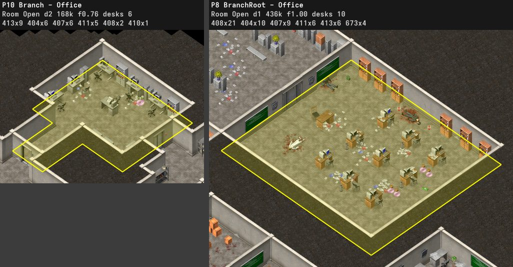 |
| lab | 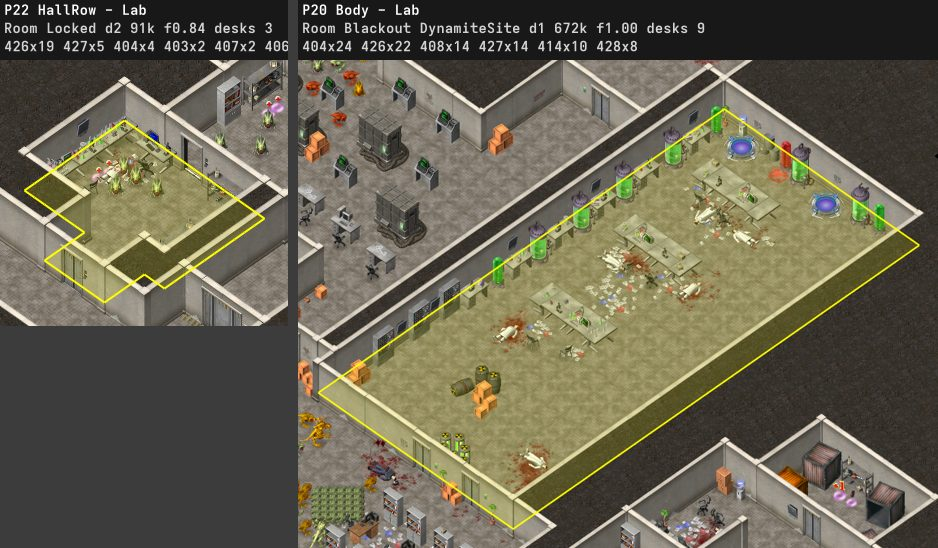 |
| computer room | 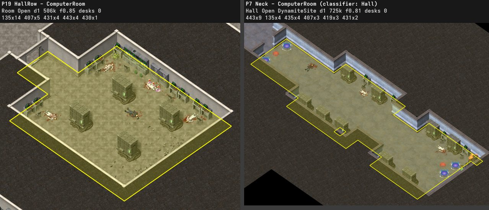 |
| machine room | 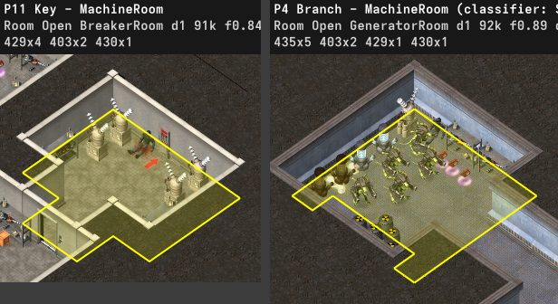 |
| storage | 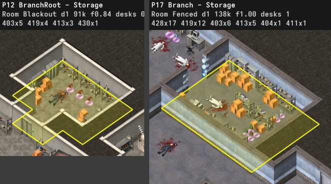 |
| depot | 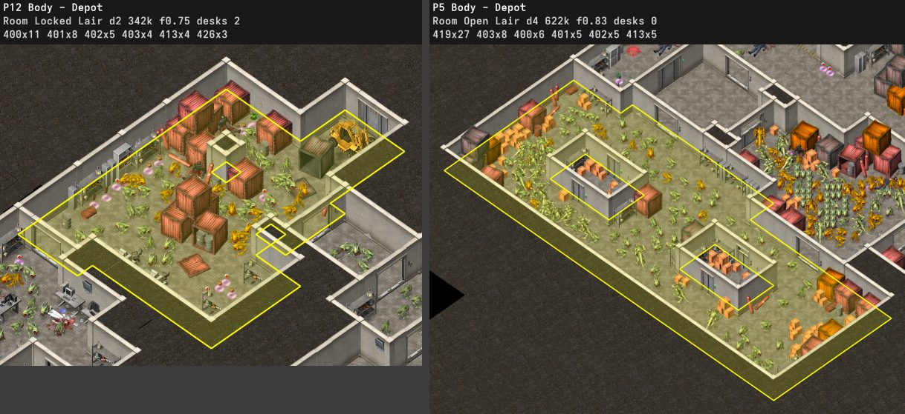 |
| hall | 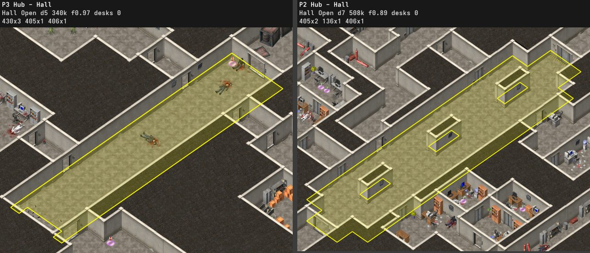 |
| hall with an office side | 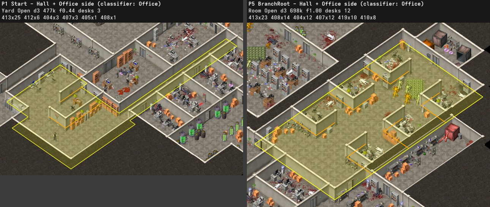 |
| quarters | 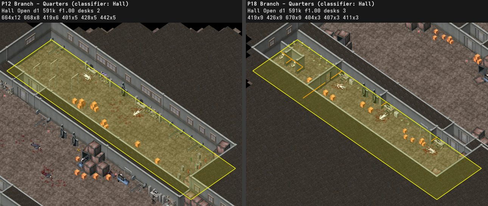 |
| passage | 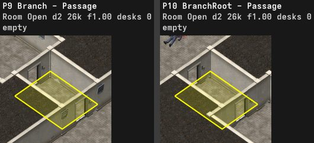 |
| arena | 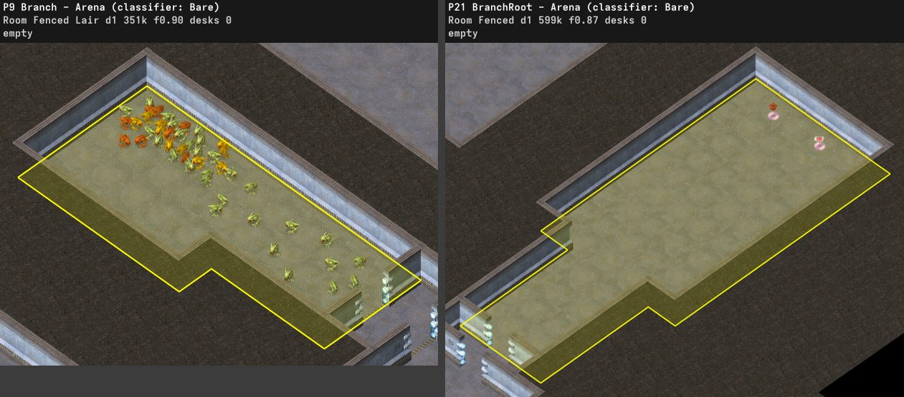 |

### Furniture

- Furnished rooms are at least 31,000 px² and hold at least three pieces.
- Room floors are boxes with corner cuts. Rooms under 18 units have no cuts, and neither do 80% of those from 18 to 45 units. Rooms from 45 to 180 units have 0 to 4 cuts in the shares 41, 24, 26, 6 and 2%, and the larger ones in the shares 24, 15, 44, 13 and 5%. Cuts span a median of 30 to 39% of the box's width and 33 to 42% of its length, and 11% of its area. The box's long side is a median of 1.33 to 1.54 times its short side, and by size the room fills a median of 100, 87 and 77% of its bounding box.

### Wall decor, gore and repetition

Measured on campaign levels 2 to 10. Far walls are the two upper edges of a cell, the side that faces the camera, and near walls the two lower edges.

- Cabinet 413's frames are different furniture. Frames 170 and 192 are narrow lockers that stand side by side 0.25 lattice units apart, and the other frames are wide cabinets and shelving kept 0.49 to 0.95 apart. Cabinets stack in tiers 27 units apart.
- Campaign furniture keeps clear of the walls at its ends, with a distance that depends on the frame. Bookcase-frame cabinets (21) keep at least 0.75 lattice units clear and desks 0.83 to 1.02. Campaign tables that face the same way stand at least 1.22 apart, and a desk at frame 0 stands at least 1.32 from a frame 21 bookcase. Every original office has a desk, small ones included (25 of 25 under 200 half cells).
- The embedded shadow 144 is a soft dark patch. The campaign puts one under every table, under 79% of shelves, 41% of cabinets and the bio containers of the basement levels (none of the concrete levels'), two under each cash pickup (246 under 123), several under extra lives and weapons, 112 among blood pools, and 653 by themselves as floor shading. Campaign offices hold crates in 1 of 36 rooms, against a wall, and add-on offices in 16 of 31, mostly on open floor.
- Gore is laid out as victims, each a corpse with a pool and small blood on one spot, placed by room type. Gibs lie only where the blood of several victims runs together.
- Soldier corpse 430 pictures 0 and 1 are seated poses, each leaning against a far wall of one direction or a container.
- Picture sets (wall objects 130, signs 131, the electric panel 136, monitors) show one picture per far wall direction, chosen by the direction byte.
- Breakable and spawn walls hide shadows in the closet behind them.
- Placed monsters face random directions (a median of 12% of a group share one facing).
- No room of an original repeats the decor of another room of the same level.
- Add-on 1 level 5 reuses a room of level 8 (42 of 55 objects at the same offsets) and the stripes around its cannon.

### View and pacing

Measured on campaign levels 2 to 10. "On screen" means within the 1,280 by 800 screen around a point of the tour, neighboring rooms included.

| measure | originals |
|---|---|
| room length over width, median and 90th percentile | 1.6 and 2.7 |
| tour between fights that hold 5% or more of the hit points, quartiles (share of the tour) | 0.03, 0.08, 0.14 |
| walk from the start to a dynamite site, 10th, 50th and 90th percentile | 1,850, 4,883 and 9,829 px |
| monsters first on screen more than 1,000 px of tour before they are reached | 39% |
| breakers first on screen more than 1,000 px before they are reached | 2 of 4 |

- On levels 4, 7, 8 and 9 the tour passes half the sites before it carries the charges and comes back to them later, as with the two sites in level 8's start hall (on screen at p 0.03 and 0.06, planted at 0.87 and 0.93) and three sites of level 9 (on screen at p 0.31, planted at 0.94 to 1.0). Most add-on sites are planted as soon as they come into view.
- Breakable walls (609) show hairline cracks of their own, and they aren't marked in any other way. Decor near the 33 campaign breakable walls is only slightly richer than near ordinary walls. Wall objects 130 stand near 21% of them against 3% of ordinary walls, barrels near 21% against 3%, and blood pools near 18% against 3%.

### Patterns

| pattern | levels |
|---|---|
| Locked doors the player sees from the start long before the breaker opens them | 2, 3, add-on 1 level 2 |
| Blood and corpses in the rooms before the first fight | 2, 3, 4, 5 |
| A monster-free branch that opens with the gate and holds money and ammo | 2, 3, 4 |
| A weapon or a pile of supplies in or right before the largest placed group | 3 (minigun), 4 (grenade launcher), 10 (arena stockpile) |
| A large ambush triggers at or just before the key | 4 (breaker, 107 monsters), 6 and 7 (room before the generator), 10 (second generator, 1,408 monsters), add-on 1 level 2 (breaker) |
| The checkpoint comes before the encounter with the most hit points | 4, 5, 8, 10 |
| The boss stands in a dead-end room or hall late in the tour, beside a site on levels 3 and 8 | 3, 5, 8, add-on 2 level 5 |
| Charges lie in batches away from the sites, and the tour walks back across the level to plant them | 4, 7, 8, 9 |
| The cannon stands in the largest place on the tour | 7, 8, add-on 1 levels 4 and 5, add-on 2 level 5 |

## Alien Shooter 2 walk

The route analysis of the original levels does not fit Alien Shooter 2, whose floors don't follow any lattice. Instead, its levels are walked over the engine's height grids (see [FORMATS.md](FORMATS.md#movement-and-collision)), by `analyze` and the map viewer.

- **Steps.** The walk visits the main-line quests (line 1) in `TimeLine` order.
  - Quests count where a trigger area starts them, or where a script variable that their starting stack waits for gets set, such as dynamite sites.
  - Starts that don't have a place, such as a dialog of an NPC parked off the map, are left out. Quests that a stack starts once another quest begins, and that don't have a trigger area, begin with that quest, such as the quest that shuts down the electric doors.
  - Later quests prefer a place the earlier ones haven't used.
  - After a quest start come the sprites named by its `ChangeStateItem` entries, at the place their stacks move them to with `ACT_CHANGE_COOR`, such as monster generators that wait off the map. For a quest that no trigger starts, the entry starts it.
  - A `CSI_DEATH` entry becomes one step for each sprite of that name. The walk takes them nearest first from where the player stands, and numbers the steps in the order it reaches them. Sprites to destroy count as reached within 450 pixels, about the reach of a shot on screen, and as destroyed once any walk passes that close, such as a device that the robot passes.
  - The level ends at the start of a quest with `WinOnBegin`, once a quest that a stack follows with such a quest begins, or otherwise at the exits of the latest quest the map starts.
- **Ground.** The solid and outline objects, the objects linked to them and the dummy blocks 630 to 632 raise the two height grids by the heights of their current frames, and the ground under each footprint follows the scan of the engine, including its tolerance of 7. Each step must stay within the climb and drop of the walker. The outline objects raise the grids by their sprite heights. The step test compares the ground of the footprint at the next cell with the height of the cell under the walker's center, taken 8 pixels behind it where a game step takes 3 pixels, and the climb allowed over a slope is scaled by 17 / 12. Ledges must also respect the climb limit on their own. Slopes steeper than about 0.83 pixels of height per pixel, such as the barbed wire and the meshes of the generators, cannot be walked up.
- **Floor.** Only cells under some sprite can be walked on. The solid objects cover the cells they raise, and surface sprites and non-solid scenery cover their frame rectangles, and a sprite that has opened keeps covering its floor. The empty space between the separate scenes of a map stays unwalkable.
- **Boxes.** Objects and objects linked to them block their footprint where their heights meet the player's when their `MoveMask` shares a bit with the player's, such as the dummy blocks of the electric doors. Scenery (`SpriteClass` 8), units, flying units, shells, the dummy markers of the editor and the objects the player can shoot down are left out.
- **Openings.** Sprites that the scripts open, break or remove open with the quest that their stack or `if` block waits for. The walk to a step uses only the openings of the quests begun by then. The grid is rebuilt whenever more of them open. Openings behind a trigger area or a script variable are described under Triggers. Electric doors stay shut until their security computer is dealt with, and boxes that play a death animation, such as the fang doors, also open with the quest.
- **Open from the start.** The objects the player can shoot down (hittable, with hit points), such as barrels and glass partitions.
- **Triggers.** Sprites that open, break or turn into something else when the player comes within the radius of a `FlagmanTrigger`, or once a trigger has set the variable they wait for, stay closed until the walk enters that area by the distance of the scripts. Triggers that the walk passes fire by themselves. When a step cannot be reached the walk goes to the trigger whose area it can reach and from which the step is reachable once everything is open, and only the triggers that set a variable, such as the button of a gate, become steps. Sprites no trigger opens are open from the start.
- **Downloads.** The question mark triggers that call `ScriptEvent16` are steps of the walk, in the order of their names, and the level ends with the last one when a quest that wins on begin follows. They happen while the quest before the winning one is active and the sprites that open with a later quest are still closed.
- **Detours.** When a step cannot be reached, the walk begins the quests that open sprites by destroying their objects, such as one that begins when power units are destroyed, and tries again.
- **Skips.** Key presses that move the player once a quest has begun, such as a space bar press, move the player to the destination before the first step that comes after the quest.
- **Teleports.** Teleports, lifts and teleport triggers link their area to their goal point.
- **Search.** The search is A* over 8 pixel cells, with 8 neighbors and without corner cutting, to a free cell within 64 pixels of the step, or inside the trigger area of a step that has one.
- **Controlled units.** A `ScriptEvent15` trigger gives the player control of a unit. When the player cannot reach a step, the player walks to such a trigger and the unit walks the steps with its own size, climb and drop until the player can reach one again. The panel next to the projection screen 2338 gives the player the robot 3040. The robot destroys the power units. Steps nobody reaches get a straight line.
- **Level scripts.** The `if` blocks of the level script are placed where their conditions come true, in a `SizeTo(Flagman(0), x, y) < r` area, at the places that start a quest it checks, or at the places that set a variable it tests.
